# Nature Shield · Operator screen

**Live demo: https://naturalsh.github.io/operator-screen/**

Published from `main` by GitHub Actions ([workflow](.github/workflows/pages.yml)); the screenshot
[docs/15_live_site.png](docs/15_live_site.png) was taken from the live site.

One screen for the response operator: **caller reports** (Voice intake), **street access** (Road Check)
and the **fire front** (Fire modelling) on the same map and the same clock.

Nature Shield is a Greece – Türkiye Hackathon 2026 project with three tools: a voice agent that takes callers'
reports, Road Check, which reads aerial photos to say which streets a rescue vehicle can use, and a wildfire
spread model. This repository is the shared screen that puts their outputs together. It is a static web app
(Vite, React, MapLibre GL) that reads three data files per scenario; there is no server and nothing is sent anywhere.
The sample scenario replays the Marmaris wildfire of 21–24 June 2022.

> Decision-support prototype. A human confirms every decision. It is not an evacuation order;
> follow official instructions (112 / AFAD / ΓΓΠΠ).

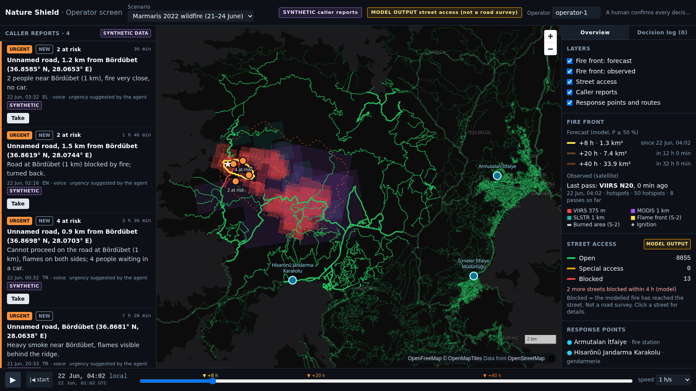

| A caller selected: streets within 600 m are highlighted | Slider at ignition + 40 h |
|---|---|
| 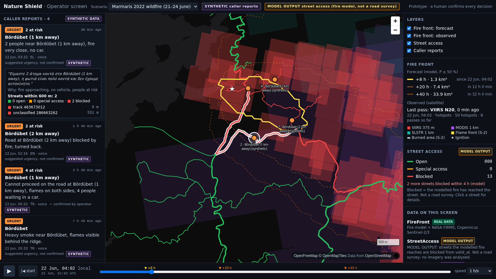 | 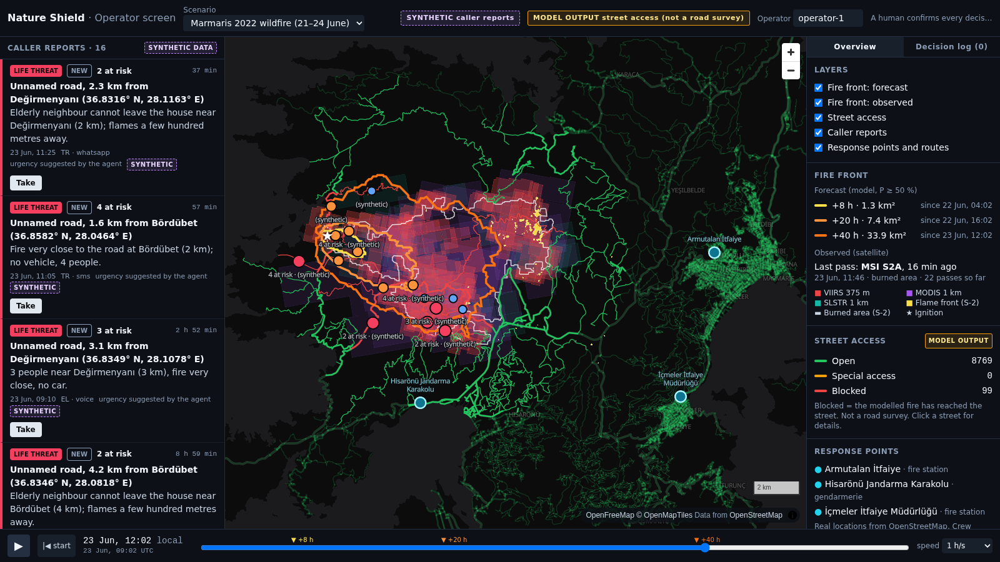 |

Without internet the packaged basemap is used: [docs/04_offline_basemap.png](docs/04_offline_basemap.png).

| Dispatch: route avoiding blocked streets | No access by road |
|---|---|
| 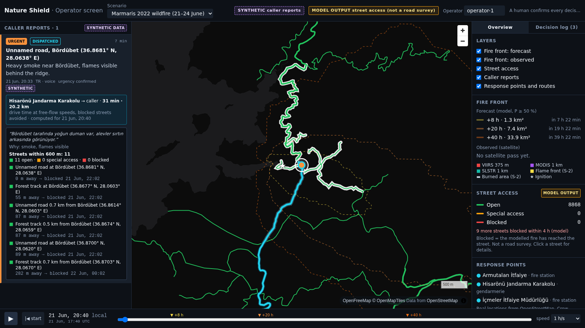 | 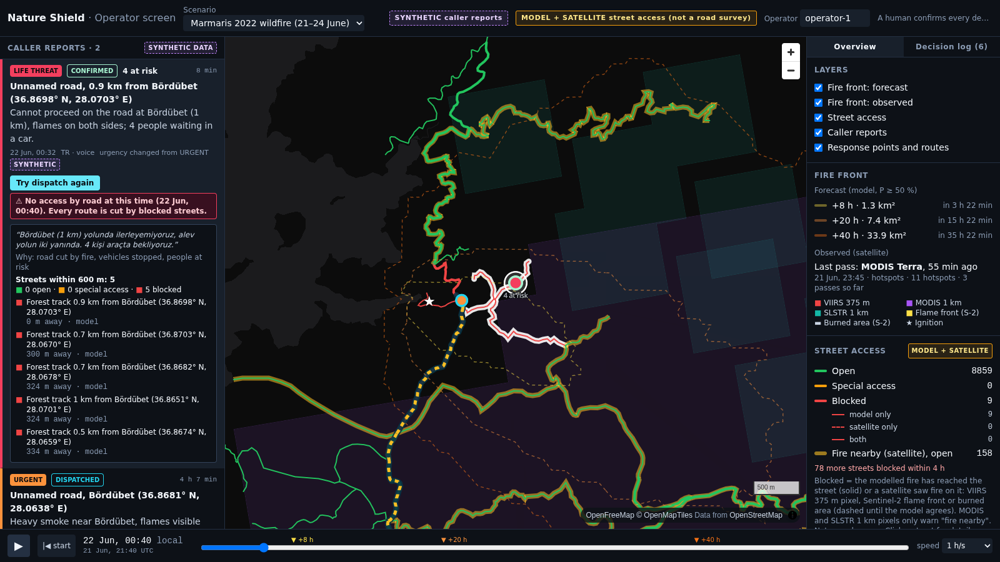 |

| Route cut later: warning and a new route | Decision log |
|---|---|
| 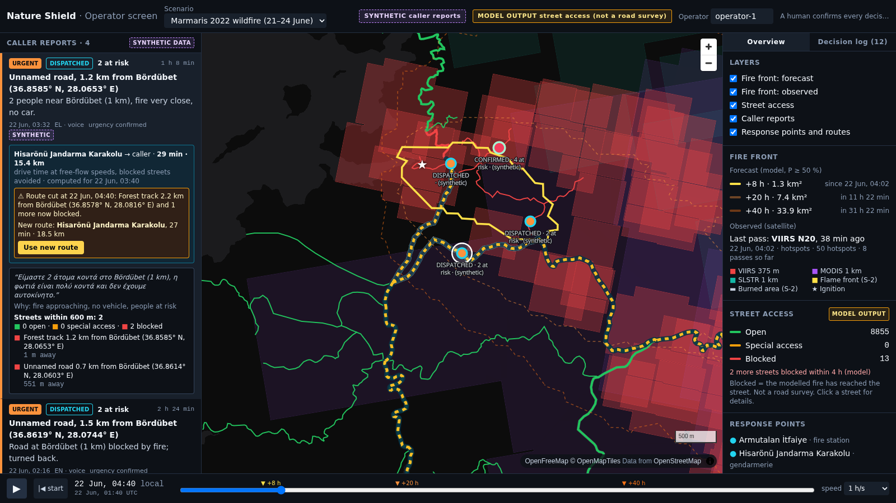 | 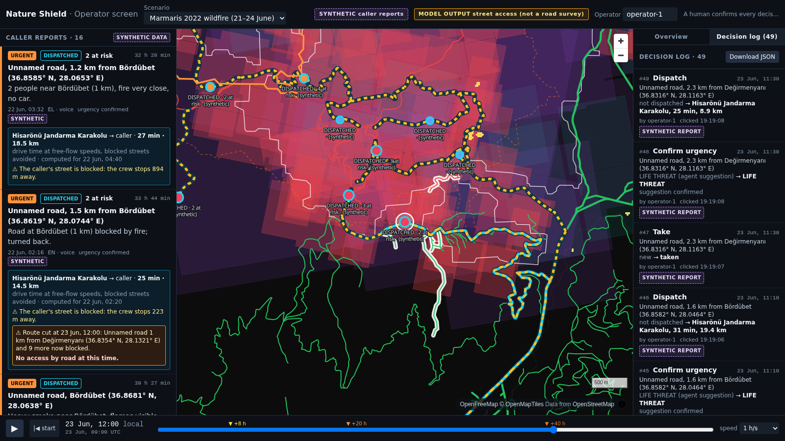 |

Popups (click a street, a caller, a response point, a satellite detection or a forecast line):
[street](docs/09_popup_street.png), [caller](docs/10_popup_caller.png),
[response point](docs/11_popup_responder.png), [satellite detection](docs/12_popup_satellite.png).
Street status from the model or a satellite, 22 June 04:02 local: [map](docs/16_satellite_closures_0402.png),
[satellite closure popup](docs/17_popup_satellite_closure.png), [fire nearby popup](docs/18_popup_fire_nearby.png).
The eastern cluster at 22 June 04:10 before and after the repeated-detection rule and the halo fix:
[before](docs/19_cluster_0410_before.png), [after](docs/20_cluster_0410_after.png).
Caller labels at the overview zoom and zoomed in: [overview](docs/13_labels_overview.png),
[zoomed](docs/14_labels_zoomed.png).

## Simple and Detailed

The switch in the header changes how much the map shows (add `?mode=detailed` to a link to open in Detailed).

- **Simple** (default): the forecast in force as an area (the next horizon not reached yet filled in orange with a
  white edge, later horizons as thin outlines, each tagged "+4 h / +8 h / +12 h"), everything satellites have
  seen so far in one light colour, closed roads (solid red: seen by satellite; orange dashed: forecast closure),
  callers, crews and their routes.
- **Detailed**: adds the satellite sensors in their own colours (VIIRS, MODIS, SLSTR, Sentinel-2 flame front and
  burned area),  the initial forecast made at
  ignition and the "fire nearby" warning.

The **legend** is a small button under the zoom buttons; it opens there, on a translucent panel, and lists the
lines and colours of the mode shown. "Fire nearby (satellite)" is a separate layer, off by default; when on,
it is drawn only within 1 km of the selected caller and of active crew routes. Streets that no forecast so far
has come within 3 km of, mostly the town of Marmaris, are drawn at 7 % opacity; crew routes over them stay
fully visible.

### Only what is known at the time shown

The screen never states what will happen later in the replay. A street is closed from the moment a forecast in
force or a satellite pass closes it; before that the only note is what the forecast in force says
("forecast: fire may reach it by 14:30"). Reasons in a popup name only the sources that have closed the street
by then, the faint/bright street styling uses only forecasts issued so far, and the time bar marks only
forecasts already issued. `tools/test_no_hindsight.py` recomputes every street closure from the data available
at 88 cut-off times and checks that the result matches the full scenario up to that time.

| 22 June 04:30 | 23 June 11:51 |
|---|---|
| 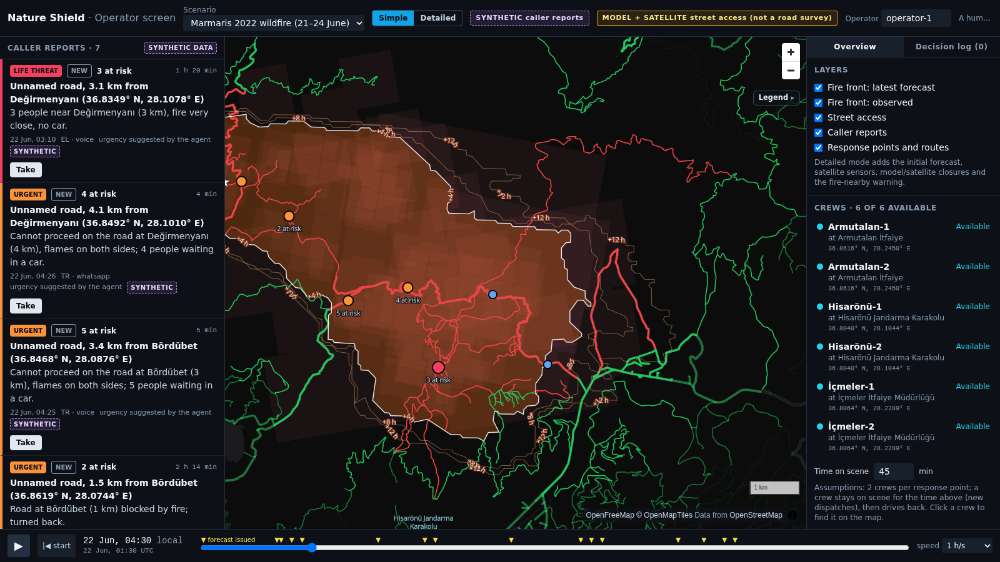 | 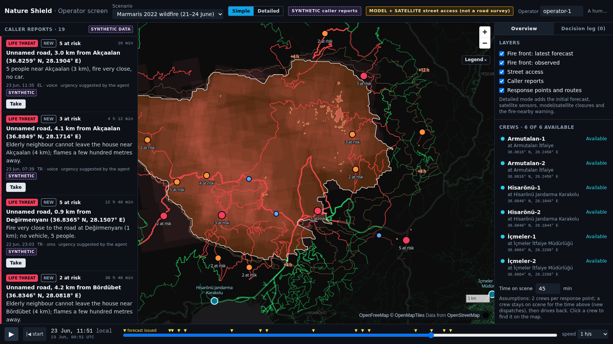 |

Side by side with Detailed (before the forecast area was added to Simple):
[22 June 04:30](docs/simple_vs_detailed_0430.png), [23 June 11:51](docs/simple_vs_detailed_1151.png).
Legend opened: [docs/simple_legend_open.png](docs/simple_legend_open.png).

## What the labels mean

| Label on screen | Meaning |
|---|---|
| **REAL DATA** | Measured or observed: satellite detections, OpenStreetMap geometry and station locations. |
| **MODEL OUTPUT** / **MODEL + SATELLITE** | Computed from real inputs; an estimate, not a survey. The forecast contours are model output. Street access in the sample scenario is MODEL + SATELLITE: a street is **closed** (solid red) once a satellite has seen fire on it, and is a **forecast closure** (orange dashed) when only the forecast in force reaches it. |
| **SYNTHETIC** | Invented sample data written for the demo so that a layer can be shown before the real tool's export exists. In the sample scenario every caller report is synthetic. No real caller data is in this repository. |

## What is real and what is synthetic

| Layer | File | Status |
|---|---|---|
| Fire front | `public/scenarios/marmaris_2022/firefront.geojson` | **Real observations + model forecasts.** Fire-model contours (the initial 8 / 20 / 40 h forecast and 16 forecast updates of +4 / +8 / +12 h) and satellite observations (NASA FIRMS VIIRS and MODIS, Copernicus Sentinel-3 SLSTR, Sentinel-2), exported by the fire tool. |
| Street access | `public/scenarios/marmaris_2022/street_access.geojson` | **Model + satellite.** Real OpenStreetMap streets (© OpenStreetMap contributors, ODbL). A street is `blocked` from its `valid_at` when the forecast in force reaches it (forecast closure: the fire repository's road-closure calculation on that forecast's P ≥ 50 % contour, 150 m safety buffer) **or** a satellite saw fire on it (observed closure) (a VIIRS 375 m pixel footprint crosses it, or the Sentinel-2 flame front or burned area is within 150 m, or MODIS/SLSTR 1 km pixels cover it in two separate overpasses between 30 minutes and 6 hours apart and a VIIRS or Sentinel-2 detection made by then lies within 1 km of it: "satellite (repeated MODIS/SLSTR)")"). A single MODIS or SLSTR pixel does not close a street; it raises a "fire nearby (satellite)" warning, drawn as an amber halo. Not a road survey: no width was measured. |
| Caller reports | `public/scenarios/marmaris_2022/caller_reports.json` | **SYNTHETIC.** Invented reports generated from the fire scenario: placed on streets that close (by forecast or satellite) and timed around that closure, so calls increase as the fire grows. Their urgency comes from a rule in the build script, not from the voice agent; cards say "synthetic, generated from the fire scenario". They never enter any measurement. |

Every synthetic record carries `"synthetic": true`, and each synthetic file has `"metadata": {"synthetic": true}`.
A file derived from the fire model has a `metadata.basis` starting with `fire_model` and may set
`metadata.label` (the sample's street file: `MODEL + SATELLITE`). The screen takes its labels from those flags, so they disappear by themselves when real files replace the samples.

## Data sources and licences

| Data | Source | Licence / terms |
|---|---|---|
| Hotspots (VIIRS 375 m, MODIS 1 km) in `firefront.geojson` | NASA FIRMS (LANCE / EOSDIS) standard-processing archive | NASA EOSDIS open data policy: free and open, no restrictions; acknowledgement requested. *We acknowledge the use of data from NASA's Fire Information for Resource Management System (FIRMS) (https://earthdata.nasa.gov/firms), part of NASA's Earth Science Data and Information System (ESDIS).* |
| Hotspots (SLSTR 1 km), flame front and burned area in `firefront.geojson` | Copernicus Sentinel-3 SLSTR and Sentinel-2 L2A, via Microsoft Planetary Computer | Copernicus Sentinel data: free, full and open access. Contains modified Copernicus Sentinel data (2022). |
| Forecast contours in `firefront.geojson`; street status in `street_access.geojson` | Nature Shield fire model (Rothermel, minimum travel time, Monte Carlo) | Model output of the project's fire tool. |
| Street geometry, station locations, place names (`street_access.geojson`, `responders.json`, `tools/osm/`) | OpenStreetMap, via the Overpass API | © OpenStreetMap contributors, Open Database Licence (ODbL) 1.0. Files derived from it stay under the ODbL. |
| Basemap (online, and the packaged copy in `public/basemap/`) | OpenFreeMap tiles, OpenMapTiles schema, OpenStreetMap data | © OpenStreetMap contributors (ODbL); © OpenMapTiles; tiles by OpenFreeMap. |
| Caller reports (`caller_reports.json`) | Written for this demo | Synthetic, CC0-1.0. |

Each record also carries its own `source`, `source_url`, `license` and `fetched_at`. Some `source_url` values
point at the fire tool's repository, which is private.

No licence has been chosen yet for the code in this repository.

## Run

Needs Node 20 or newer.

```bash
npm install
npm run dev          # http://localhost:5173
```

Other commands:

```bash
npm run validate     # check every data file against schemas/*.schema.json
npm run routes       # table: drive time from each response point to each caller
npm run build        # type-check and build into dist/
npm run preview      # serve dist/ on http://localhost:4173
```

Deep link to a moment, for rehearsals: `?t=2022-06-23T09:02:00Z&call=synthetic-call-005`
(`t` = UTC time, `call` = id of the report to select, `scenario` = scenario id).

### Basemap, online and offline

The basemap is the OpenFreeMap dark style. If it cannot be reached within 3 seconds when the page loads,
the app switches to the copy packaged in `public/basemap/` (10 MB: vector tiles for zoom 0–14 over
27.85–28.45° E, 36.65–37.05° N, fonts, sprites, style) and shows "Offline basemap" on the map. Outside that
box the offline map is empty. The three data layers are always local files.

- Rehearse without unplugging the network: add `?basemap=offline` to the address.
- Rebuild or change the area: edit `BBOX` / `MAX_ZOOM` in `tools/fetch_basemap.mjs`, then
  `node tools/fetch_basemap.mjs` (it refuses to exceed 100 MB).
- Map data © OpenStreetMap contributors (ODbL), schema © OpenMapTiles, tiles by OpenFreeMap.

## Using the screen

- **Scenario** (top): picks an entry of `public/scenarios/index.json`.
- **Time bar** (bottom): play / pause, slider in 10-minute steps, speed. Marks show when each forecast becomes valid.
  Everything follows this clock: reports appear at `reported_at`, satellite observations at `valid_at`,
  a forecast contour turns solid at `valid_at` and is dashed before that.
- **Map markers**: caller colour = urgency, ring = the operator's step; the label shows the people at risk.
  Labels that would overlap are hidden, the most urgent kept, and appear when you zoom in. Click anything on
  the map for a popup with its details and source.
- **Caller reports** (left): reports received so far, life threat first, then urgent, then routine; newest first
  within a class. Click a report (or its marker) to see the caller's own words, the reasons for the suggested
  urgency and the streets within 600 m with their access class; those streets are outlined in white on the map.
- **Street access**: green = open, orange = special access, red = blocked. In the sample, solid red = closed, fire
  seen there by a satellite; orange dashed = forecast closure, the forecast in force reaches the street but no
  satellite has seen fire there yet (crews are routed around both); amber halo = open but a 1 km
  satellite pixel with fire covers it. The right panel splits the blocked count into model / satellite / both,
  and the popup names the source ("Blocked since 22 Jun, 04:02 — satellite (VIIRS N20)"). Road Check classes are open
  (free width ≥ 3 m), special access (2 m to under 3 m) and blocked (under 2 m). A status can start at a time
  (`valid_at`): in the sample scenario a street turns orange dashed when the forecast in force reaches it and solid red
  when a satellite has seen fire on it. Click a street for details.
- **Right panel**: layer toggles, forecast and latest satellite pass, street counts, and which files are real.

## Forecast updates

The fire model does not run once. A forecast is issued at ignition, at every new VIIRS overpass or Sentinel-2
image (started from the union of everything those sensors have seen so far) and at least every 6 hours in
between; each has contours for +4, +8 and +12 hours. The screen shows the forecast in force at the current
time, with its issue time and what it was started from ("Forecast issued 22 Jun, 04:02 from VIIRS perimeter");
contours are dashed until their hour is reached. The yellow ticks on the time bar are the issue times.
The layer "Fire front: initial forecast (at ignition)" adds the single 8 / 20 / 40 h forecast made at ignition,
in blue, for comparison. A street's model closure comes from the forecast that is in force when its contour
reaches the street.

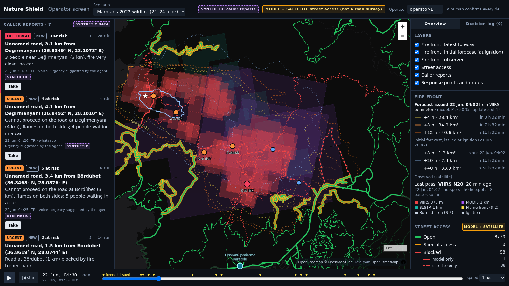

How the forecasts compare with later satellite data, updated forecasts against the single forecast made at
ignition. For each update and horizon, the FIRMS hotspots (VIIRS and MODIS) acquired between the issue time and
issue + horizon are counted. Overlapping updates count a hotspot once each, so the number of distinct hotspots is
given too. "New ground" means outside the area the update started from. The share of hotspots inside a forecast is
a recall and rewards large forecasts; the last column gives the other side: of the area a forecast adds beyond
its starting area, the share that any VIIRS or Sentinel-2 observation of the whole event saw burning.

| Updates | Horizon | Hotspot detections (distinct) | Inside updated | Inside one-shot | New ground: detections (distinct) | New ground inside updated | New ground inside one-shot | Forecast new area seen burning (updated / one-shot) |
|---|---:|---:|---:|---:|---:|---:|---:|---:|
| all 16 | +4 h | 807 (478) | 74.5 % | 8.9 % | 331 (258) | 37.8 % | 3.3 % | 52.7 % / 39.5 % |
| all 16 | +8 h | 1267 (536) | 63.0 % | 11.4 % | 706 (417) | 33.6 % | 6.4 % | 43.8 % / 42.5 % |
| all 16 | +12 h | 1741 (539) | 71.6 % | 13.4 % | 974 (448) | 49.3 % | 7.9 % | 36.8 % / 45.6 % |
| 2 started from the ignition point | +4 h | 167 (167) | 1.8 % | 3.0 % | 167 (167) | 1.8 % | 3.0 % | 100 % / 99.1 % |
| 2 started from the ignition point | +8 h | 323 (167) | 3.4 % | 5.6 % | 323 (167) | 3.4 % | 5.6 % | 95.4 % / 95.2 % |
| 2 started from the ignition point | +12 h | 351 (195) | 6.8 % | 9.1 % | 351 (195) | 6.8 % | 9.1 % | 93.5 % / 92.7 % |
| 14 started from a satellite perimeter | +4 h | 640 (423) | 93.4 % | 10.5 % | 164 (121) | 74.4 % | 3.7 % | 52.4 % / 37.1 % |
| 14 started from a satellite perimeter | +8 h | 944 (481) | 83.4 % | 13.5 % | 383 (280) | 59.0 % | 7.0 % | 43.2 % / 39.0 % |
| 14 started from a satellite perimeter | +12 h | 1390 (484) | 88.0 % | 14.5 % | 623 (296) | 73.2 % | 7.2 % | 36.0 % / 41.3 % |

Reading it: started from the ignition point, the model misses almost all of the first night's spread. Started
from a satellite perimeter, the forecast contains most later hotspots on new ground, but more than half of the new
area it forecasts at +8 and +12 h was never seen burning: it over-predicts, increasingly with the horizon.

**Caveats: in-sample parameters, hindcast weather, zero satellite latency.** Four model parameters
(r0_multiplier, gust fraction, wind-direction spread, length-to-breadth cap) were set on this same fire; the
weather is the archived Open-Meteo historical forecast, not the forecast available at the time; each update is
issued at the overpass minute, while real near-real-time data arrive hours later. This is a replay of one fire,
not a validation. Full table: [docs/forecast_skill.md](docs/forecast_skill.md).

The updates are computed by `tools/build_marmaris_scenario.py` with the fire repository's model, on its
reconstruction grid (forecasts stop at that grid's edge) and its cached weather, which ends on 23 June:
the last update is issued on 23 June at 14:14 local. The model has no suppression, so late updates over-predict.

## Crews

Each response point has **two crews** (an assumption, stated on screen), e.g. Armutalan-1 and Armutalan-2.
A crew goes **available → en route → on scene → returning → available**; it stays on scene for 45 minutes by
default (adjustable in the Crews section, logged; applies to crews sent afterwards) and then drives back.

- **Dispatch** sends the nearest free crew. With the report card selected, the suggested crew is shown with its
  ETA and every other crew is in a list with its own ETA: available and returning crews freely, crews on their
  way to another incident marked ⚠ ("Reassign … here"), which the operator has to pick explicitly.
- A **vehicle icon** moves along the route with the time slider; the card and the icon count the ETA down.
- If a street on the route becomes blocked while the crew is driving, the vehicle **stops where it is**, the card
  says which street cut the route and offers a **new route from the vehicle's position**.
- **Reassign**: a crew en route can be redirected to another waiting incident. The incident it leaves becomes
  **UNASSIGNED**, moves to the top of the list and shows a warning.
- The **Crews** section lists each crew's status, position and incident; click (or tap) a crew to move the map to it.
- Every step (dispatch, reassign, the incident left unassigned, re-route, setting change) is in the decision log.
- Crews and missions live in the page; reloading clears them. Moving the time slider back undoes nothing:
  positions and statuses are recomputed for the time shown.

| Suggested crew and candidates | Vehicle en route with ETA | Route cut, new route from the vehicle |
|---|---|---|
| 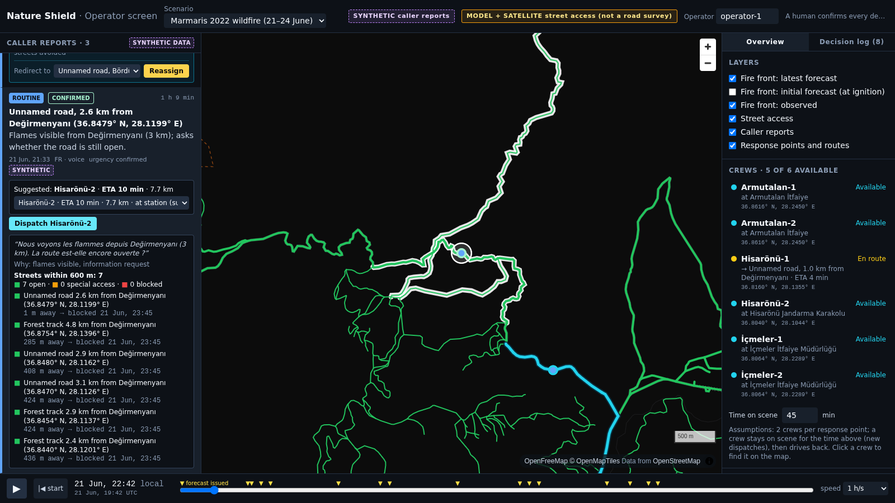 | 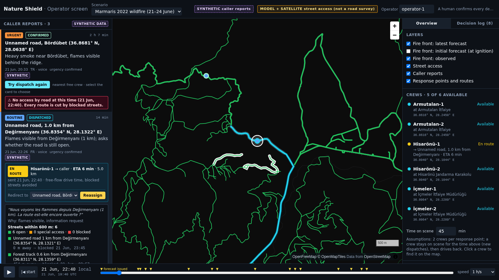 | 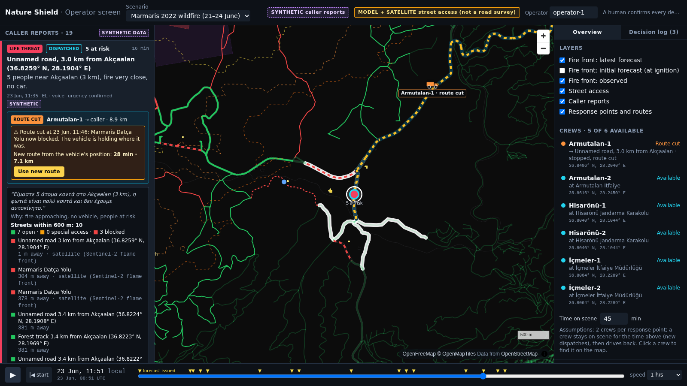 |

More: [Crews panel](docs/crews_1_crews_panel.png), [unassigned incident](docs/crews_4_unassigned.png),
[decision log](docs/crews_5_decision_log.png), [returning crew, map on it](docs/crews_6_returning_focus.png),
[phone: crews](docs/crews_8_phone_crews.png), [phone: crew tapped](docs/crews_9_phone_crew_focus.png).

## On a phone

Below 768 px the map fills the screen and starts on the fire. The reports, the layer panel and the decision
log open from the bottom as a drawer with three tabs (**Reports / Layers / Decision log**); tap the open tab
to close it. The time bar stays fixed at the bottom with touch-sized controls. Tapping a report card selects
it and moves the map to the caller, in the part of the map the drawer does not cover. Scenario and operator
name are in the Layers tab. The desktop layout is unchanged.

| iPhone 390 × 844 | Reports | Card tapped | Layers | Decision log |
|---|---|---|---|---|
| 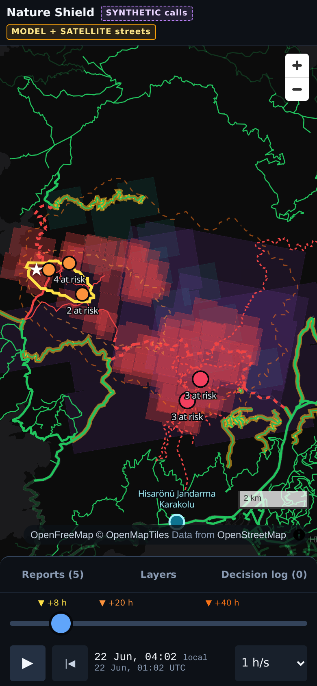 | 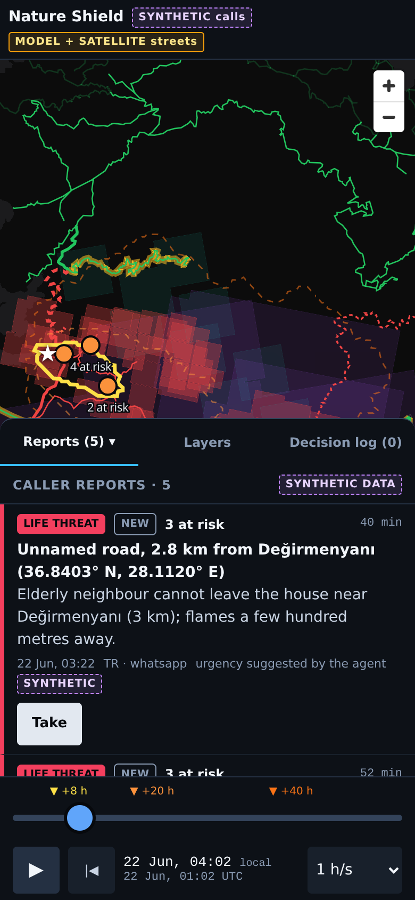 | 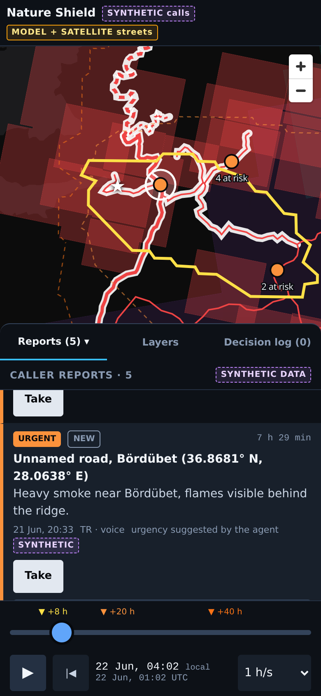 | 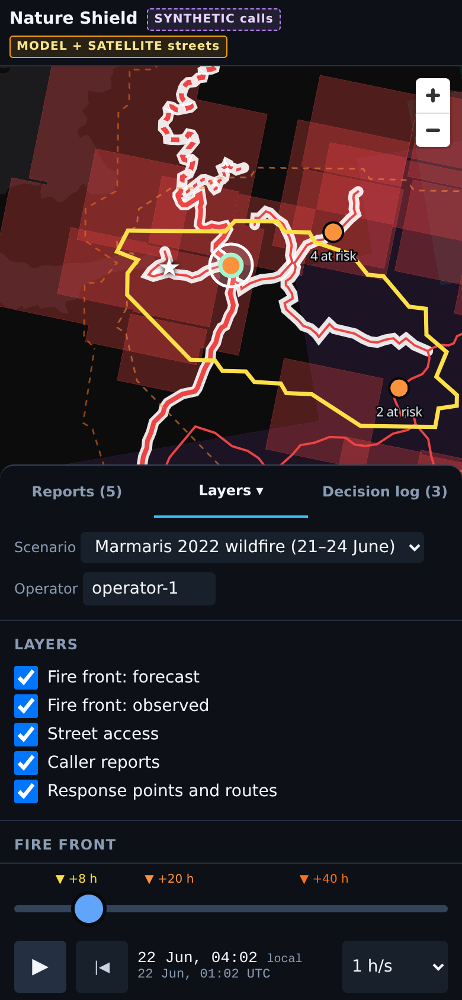 | 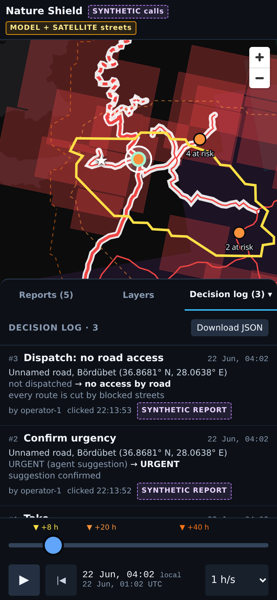 |

Held sideways (height of 500 px or less) the header is one line with the three tabs in it, the time bar is a
single thin row, and the tabs open a panel from the right that never covers more than half of the map.
Rotating the phone switches between the two layouts without reloading.

| Landscape 844 × 390 | Reports panel | Card tapped |
|---|---|---|
| 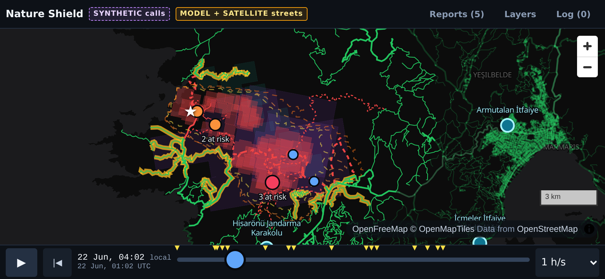 | 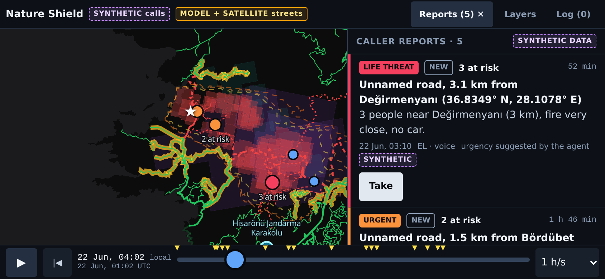 | 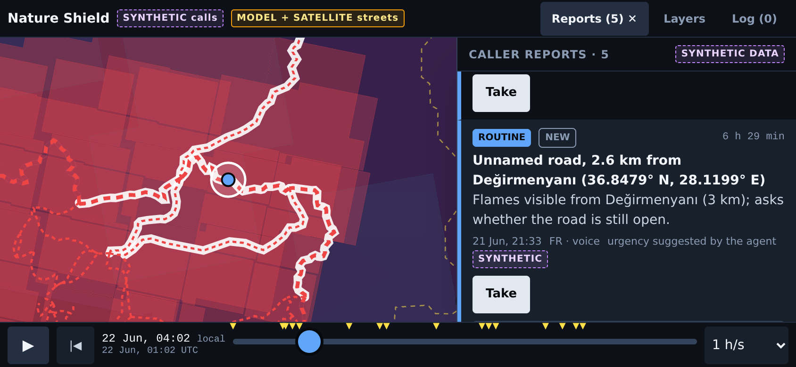 |

Landscape 800 × 360: [map](docs/phone_landscape_800x360_1_map.png), [reports](docs/phone_landscape_800x360_2_reports.png),
[card tapped](docs/phone_landscape_800x360_3_card_tapped.png), [layers](docs/phone_landscape_800x360_4_layers.png).

Android 360 × 800: [map](docs/phone_android_360x800_1_map.png), [reports](docs/phone_android_360x800_2_reports.png),
[card tapped](docs/phone_android_360x800_3_card_tapped.png), [layers](docs/phone_android_360x800_4_layers.png),
[decision log](docs/phone_android_360x800_5_log.png).

## Operator actions and the decision log

Each report card walks through three steps; nothing happens without a click.

1. **Take**: the operator picks the report up.
2. **Confirm urgency**: the agent's suggestion is preselected and can be changed before confirming.
   The list re-sorts on the confirmed urgency; the report keeps the agent's original suggestion.
3. **Dispatch**: the fastest crew is routed to the caller (see below).

The step reached is shown on the card and on the map marker (ring colour and label). Every click is written
to the **Decision log** tab on the right: scenario time, wall-clock time, operator (name field in the header),
the previous and the new value. **Download JSON** saves the log
(`{"record": "DecisionLog", "scenario": ..., "decisions": [...]}`); decisions on synthetic reports carry
`"synthetic_report": true`. The log lives in the page: reloading or switching scenario clears it.

## Crew routing

- **Response points** come from `responders.json`. In the sample they are three real OpenStreetMap locations:
  İçmeler İtfaiye Müdürlüğü and Armutalan İtfaiye (fire stations) and Hisarönü Jandarma Karakolu.
  That a crew is available at each of them is an assumption of the demo.
- **Dispatch** computes, on the scenario's street network, the fastest drive from any response point to the
  caller's street that avoids every street blocked at the current scenario time, draws it and shows the drive
  time and distance. If the caller's own street is blocked, the route ends at its nearest reachable end and the
  card says how far away the crew stops.
- If no response point can reach the caller, the card shows **"No access by road at this time"** and the
  attempt is logged. "Try dispatch again" repeats it at the current time.
- When the clock moves on and a street on a dispatched route becomes blocked, the route turns dashed amber
  and the card warns **"Route cut"** with the street; it offers a new route ("Use new route") or says there is
  no access.
- Drive times are free-flow: road-class speeds as in the fire repository's evacuation settings (trunk 70,
  secondary 50, tertiary 40, residential and unclassified 30 km/h), plus our own 20 km/h for service roads and
  15 km/h for forest tracks. One-way restrictions, turn-out time and traffic are ignored.
- `npm run routes` prints the drive time from every response point to every caller at the time of the call,
  using the same routing code as the screen. In the sample most callers are 7–45 minutes from the nearest
  point. Two are about 95 minutes away because closures block the direct road and the only way in
  is 16 km of forest tracks; the route line on the card shows the forest-track kilometres.
- Routing needs `u`, `v` (junction node ids) on the street features and a connected network; without
  `responders.json` the Dispatch button is disabled.

## Dropping in the Greek team's files

Only data files change; no code.

1. **Voice intake → `caller_reports.json`**
   `{"metadata": {"record": "CallerReport"}, "records": [ ... ]}`, each record following
   [`schemas/caller_report.schema.json`](schemas/caller_report.schema.json).
2. **Road Check → `street_access.geojson`**
   A GeoJSON FeatureCollection of LineStrings (EPSG:4326, `[lon, lat]`), each feature's `properties` following
   [`schemas/street_access.schema.json`](schemas/street_access.schema.json).
3. Put both in `public/scenarios/<scenario id>/`, overwriting the samples (or add a new folder and a new entry in
   `public/scenarios/index.json` with its `center`, `zoom`, `start`, `end` and the three file paths).
4. Leave out `"synthetic": true` in real files.
5. Run `npm run validate`. It prints the first problems per record and exits non-zero if a file does not match.

The fire front comes from the fire repository:
`python -m fireproj.export_firefront --event marmaris_2022`, then copy `exports/marmaris_2022_firefront.geojson`
to `public/scenarios/marmaris_2022/firefront.geojson` ([`schemas/fire_front.schema.json`](schemas/fire_front.schema.json)).

### The three records

All three share the same provenance fields: `schema_version`, `source`, `source_url`, `license`, `fetched_at`,
`observed_at`, `received_at` (UTC, ISO 8601). Extra fields are allowed and ignored.

| Record | Required fields | Optional |
|---|---|---|
| `CallerReport` | `id`, `reported_at`, `place` (`lon`, `lat`, `label`), `language` (`el`/`tr`/`en`/`fr`), `urgency` (`life_threat`/`urgent`/`routine`), `urgency_reasons[]`, `hazard`, `people_at_risk`, `summary`, `confirmed_by_operator` | `summary_en`, `channel` |
| `StreetAccess` | `id`, `osm_way_id`, `status` (`open`/`special_access`/`blocked`), `confirmed_by_operator`; with `basis: "imagery"` also `free_width_m` and `imagery_date` | `valid_at` + `status_before` (status that starts at a time), `basis` (`imagery`/`fire_model`/`satellite`/`fire_model_and_satellite`/`operator`), `reason`, per-source closure: `blocked_by`, `first_blocked_by`, `model_blocked_at`, `satellite_blocked_at`, `satellite_source`, `model_forecast_issued_at`, `model_reason`, `satellite_reason`; warning: `fire_nearby_at`, `fire_nearby_source`; `edge_id`, `name`, `highway`, `confidence`, `imagery_source`; for routing and labels: `u`, `v`, `length_m`, `near_place`, `label_point`, `near_fire_from` |
| `FireFront` | `id`, `kind` (`forecast`/`observed`), `valid_at`; forecast: `horizon_hours`, `model_run_at`; observed: `observation_type`, `instrument` | forecast updates: `issued_at`, `forecast_set` (`initial`/`update`), `initialised_from`; `probability`, `area_km2`, `satellite`, `detections`, `frp_mw` |
| `Responder` (optional file) | `id`, `name`, `kind` (`fire_station`/`gendarmerie`/`police`/`other`), `place` (`lon`, `lat`) | |

## Layout

```
public/scenarios/index.json           scenario list (title, map view, time window, file paths)
public/scenarios/<id>/                the three data files of a scenario
schemas/                              JSON Schema (draft 2020-12) of the three records
scripts/validate.mjs                  data files vs. schemas
tools/fetch_osm.py                    downloads the OpenStreetMap extract (roads, stations, place names) into tools/osm/
tools/build_marmaris_scenario.py      builds the scenario from the fire repository (needs its environment)
tools/fetch_basemap.mjs               packages the offline basemap into public/basemap/
src/basemap.ts                        online style with offline fallback
src/data.ts                           loading, sorting, "streets near a caller"
src/routing.ts                        street graph, fastest route avoiding blocked streets
src/components/                       MapView (MapLibre), CallerList (actions), DecisionLog, SidePanel, TimeBar
```

## Known limits

- Street access in the sample comes from the fire model in 2-hour steps and from satellite overpasses, which
  are hours apart: a street is marked from the overpass that saw the fire, not from when the fire arrived.
  A burned-area closure says the fire passed, not that the road is still impassable.
- Caller reports are invented; their texts come from a small set of templates.
- "Streets near a caller" is a straight-line distance, not a route.
- Streets more than 3 km from the fire are drawn faint; they stay in the network for routing.
- Most streets in the fire area have no name in OpenStreetMap; they are labelled by the nearest named place
  and a coordinate. "Bördübet" is the ignition locality from the fire repository's configuration, not an OSM place.
- One scenario so far. The streets cover the fire area, İçmeler and Marmaris (forest tracks and service roads included).
