# Nature Shield · Operator screen

**Live demo: https://naturalsh.github.io/operator-screen/**

Published from `main` by GitHub Actions ([workflow](.github/workflows/pages.yml)); the screenshot
[docs/15_live_site.png](docs/15_live_site.png) was taken from the live site.

One screen for the response operator: **caller reports** (Voice intake), **street access** (Road Check)
and the **fire front** (Fire modelling) on the same map and the same clock.

Nature Shield is a Greece – Türkiye Hackathon 2026 project with three tools: a voice agent that takes callers'
reports, Road Check, which reads aerial photos to say which streets a rescue vehicle can use, and a wildfire
spread model. This repository is the shared screen that puts their outputs together. It is a static web app
(Vite, React, MapLibre GL) that reads three data files per scenario; there is no server and nothing is sent anywhere.
The sample scenario replays the Marmaris wildfire of 21–24 June 2022.

> Decision-support prototype. A human confirms every decision. It is not an evacuation order;
> follow official instructions (112 / AFAD / ΓΓΠΠ).

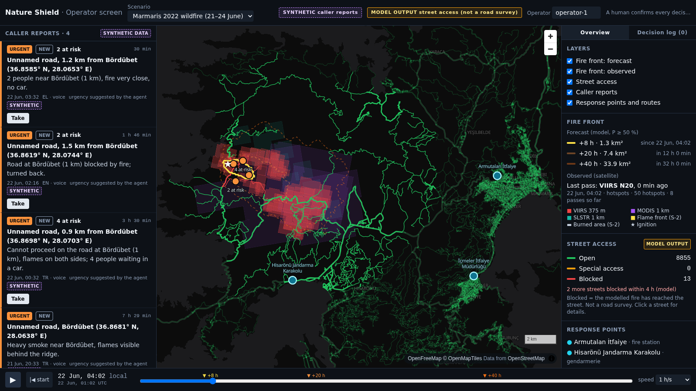

| A caller selected: streets within 600 m are highlighted | Slider at ignition + 40 h |
|---|---|
| 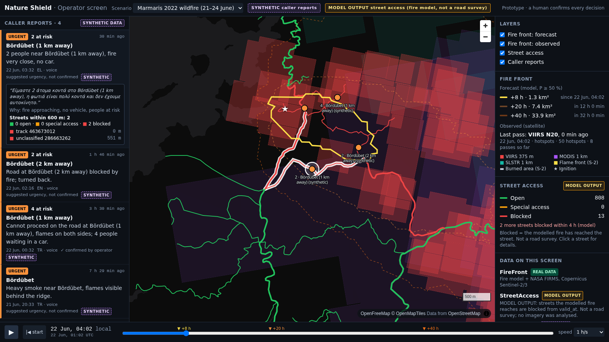 | 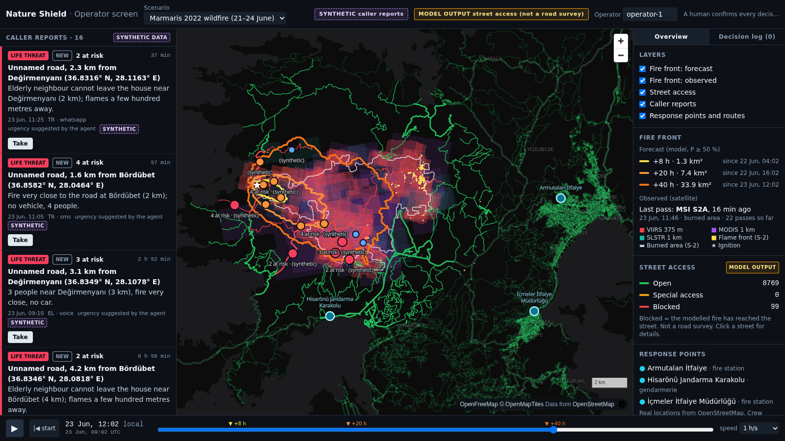 |

Without internet the packaged basemap is used: [docs/04_offline_basemap.png](docs/04_offline_basemap.png).

| Dispatch: route avoiding blocked streets | No access by road |
|---|---|
| 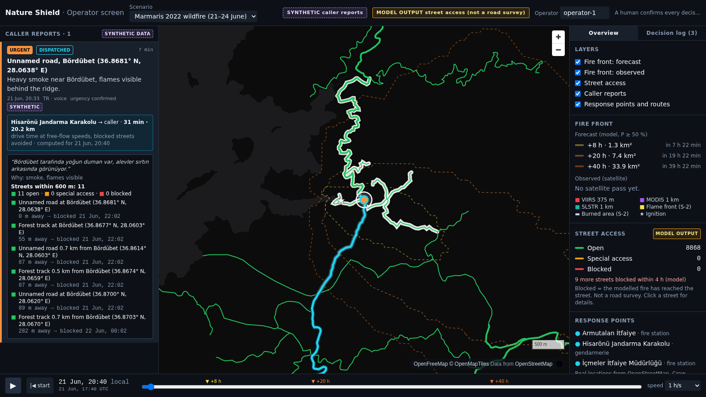 | 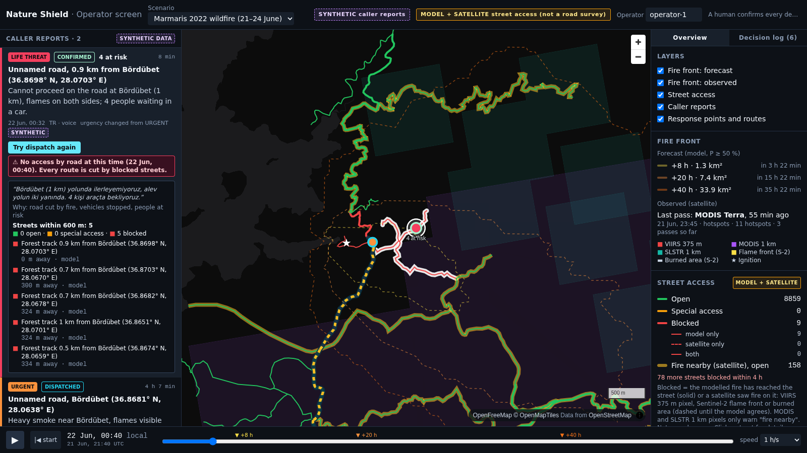 |

| Route cut later: warning and a new route | Decision log |
|---|---|
| 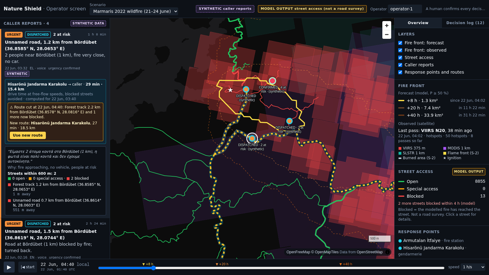 | 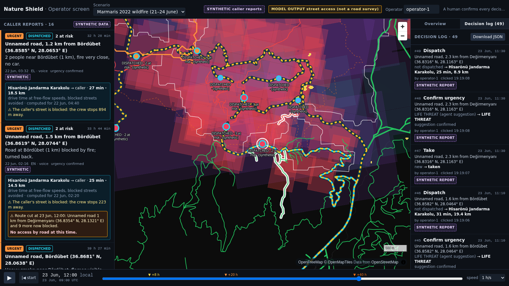 |

Popups (click a street, a caller, a response point, a satellite detection or a forecast line):
[street](docs/09_popup_street.png), [caller](docs/10_popup_caller.png),
[response point](docs/11_popup_responder.png), [satellite detection](docs/12_popup_satellite.png).
Street status from the model or a satellite, 22 June 04:02 local: [map](docs/16_satellite_closures_0402.png),
[satellite closure popup](docs/17_popup_satellite_closure.png), [fire nearby popup](docs/18_popup_fire_nearby.png).
The eastern cluster at 22 June 04:10 before and after the repeated-detection rule and the halo fix:
[before](docs/19_cluster_0410_before.png), [after](docs/20_cluster_0410_after.png).
Caller labels at the overview zoom and zoomed in: [overview](docs/13_labels_overview.png),
[zoomed](docs/14_labels_zoomed.png).

## Simple and Detailed

The switch in the header changes how much the map shows (add `?mode=detailed` to a link to open in Detailed).

- **Simple** (default):
  Three kinds of line, kept apart:
  - **Observed** (real): the fire edge VIIRS and Sentinel-2 have seen up to the last pass, a plain white line
    tagged "Seen by satellite 04:02". It moves at every new pass.
  - **Fire now (model estimate)**: the forecast in force advanced from its issue time to the time shown (its last
    30-minute contour not after it). Inside, burned ground, dark and quiet (#2a1a14 at 50 %); along its edge the
    active front, a band in one red-orange with thin light edges, 20 % of the fire's equivalent radius wide (at
    most 300 m; a fire under about 125 m across gets only an edge line). Parts under 0.3 km² apart from the main
    fire get no band, only a small mark. The legend, the forecast box and the popup say "estimate, not observed".
  - **Forecast**: one line at a time, dashed yellow, tagged "Expected by 04:55 (+1 h)". The **Look ahead** switch
    on the map picks it: Now (none) · +30 min · +1 h · +2 h · +3 h (default +1 h; Detailed adds +6 h and draws the
    other horizons faintly). Parts under 0.3 km² are left out of this line too.
  - Satellite detections: only the pixels of the **newest VIIRS pass of the last 3 hours**, faint (30 %) and
    without edges; older passes are not drawn (the burned ground covers them, and the pixels of several passes over
    the same ground stacked into dark squares), nor the large 1 km MODIS / SLSTR squares.
    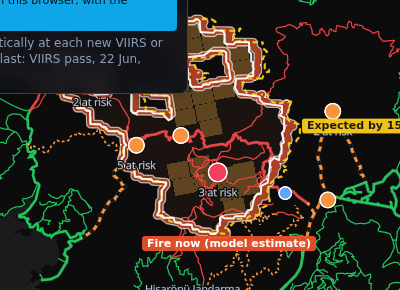 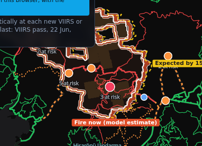
  - Callers have a thin white edge and a soft dark shadow, so they stay readable on the fire.
  - Closed roads (solid red: seen by satellite; orange dashed: forecast closure), callers, crews and their routes.
- **Detailed**: adds the satellite sensors in their own colours (VIIRS, MODIS, SLSTR, Sentinel-2 flame front and
  burned area; the last 6 hours bright, older ones dark grey), the initial forecast made at ignition and the
  "fire nearby" warning.

The **legend** is a small button under the zoom buttons; it opens there, on a translucent panel, and lists the
lines and colours of the mode shown. "Fire nearby (satellite)" is a separate layer, off by default; when on,
it is drawn only within 1 km of the selected caller and of active crew routes. Streets that no forecast so far
has come within 3 km of, mostly the town of Marmaris, are drawn at 7 % opacity; crew routes over them stay
fully visible.

### Only what is known at the time shown

The screen never states what will happen later in the replay. A street is closed from the moment a forecast in
force or a satellite pass closes it; before that the only note is what the forecast in force says
("forecast: fire may reach it by 14:30"). Reasons in a popup name only the sources that have closed the street
by then, the faint/bright street styling uses only forecasts issued so far, and the time bar marks only
forecasts already issued. `tools/test_no_hindsight.py` recomputes every street closure from the data available
at 88 cut-off times and checks that the result matches the full scenario up to that time.

Observed / model estimate / forecast kept apart, before and after (desktop; phone versions next to them in
`docs/lines_*_phone.png`):

| | 22 June 09:00 | 23 June 23:16 | 24 June 04:00 |
|---|---|---|---|
| before | 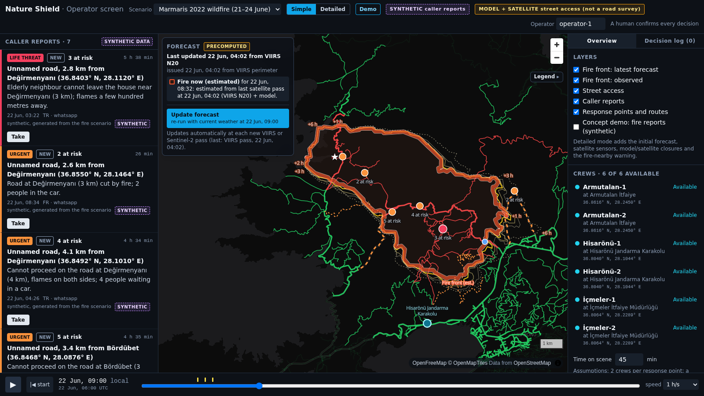 | 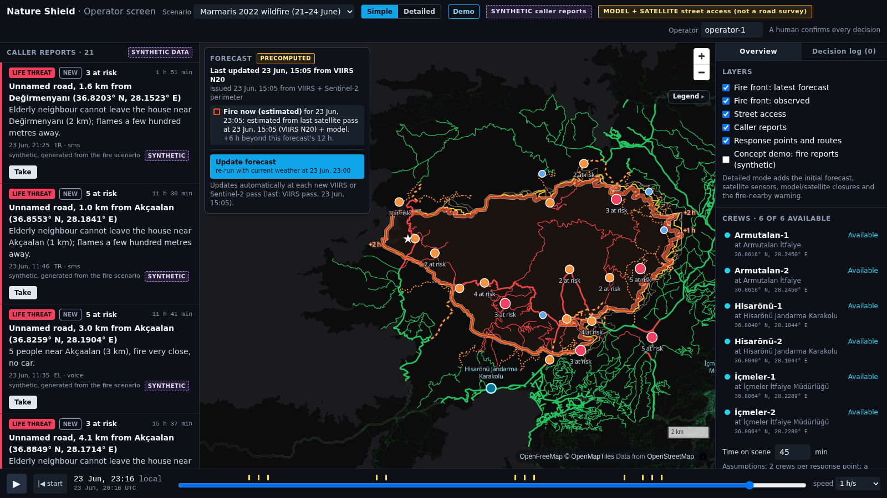 | 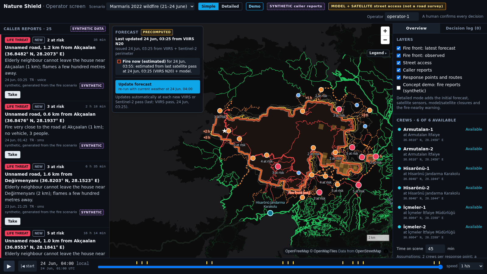 |
| after | 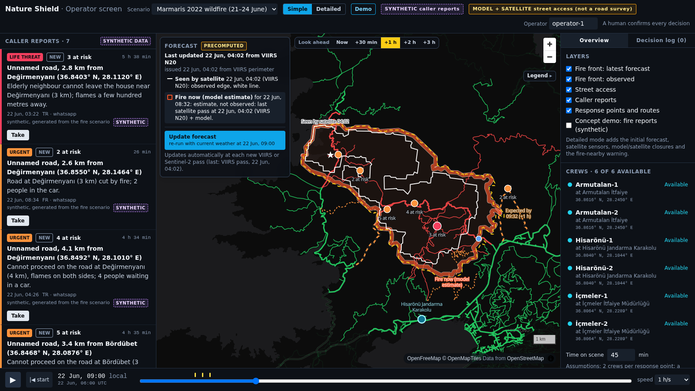 | 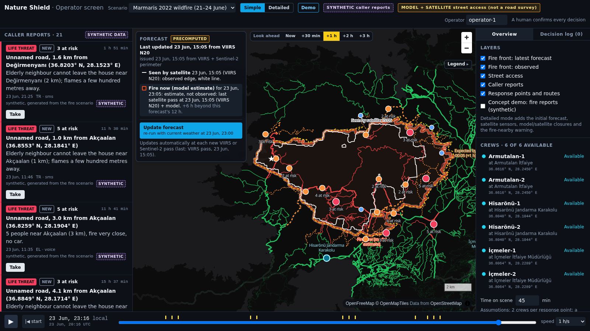 | 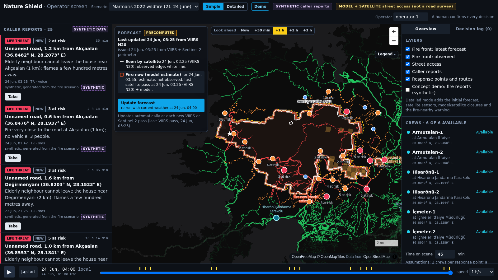 |

The first hour and a half of the fire (21 June 20:30, 21:00, 21:30 local): the front band is 20 % of the fire's
radius, so a small fire keeps its shape ([20:30](docs/early_fire_21jun_2030_desktop.png),
[21:00](docs/early_fire_21jun_2100_desktop.png), [21:30](docs/early_fire_21jun_2130_desktop.png); phone:
[20:30](docs/early_fire_21jun_2030_phone.png), [21:00](docs/early_fire_21jun_2100_phone.png),
[21:30](docs/early_fire_21jun_2130_phone.png)).

Calmer fire styling in Simple, before and after (desktop; phone:
[before](docs/calm_before_0900_phone.png) / [after](docs/calm_after_0900_phone.png) at 22 June 09:00,
[before](docs/calm_before_1151_phone.png) / [after](docs/calm_after_1151_phone.png) at 23 June 11:51):

| | 22 June 09:00 | 23 June 11:51 |
|---|---|---|
| before | 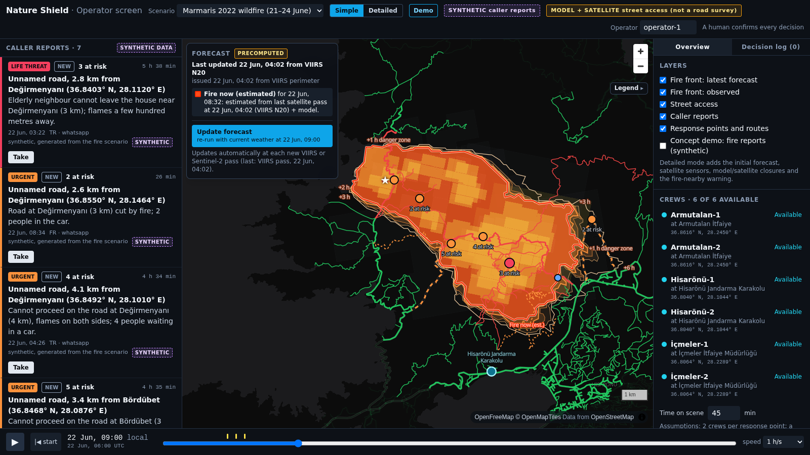 | 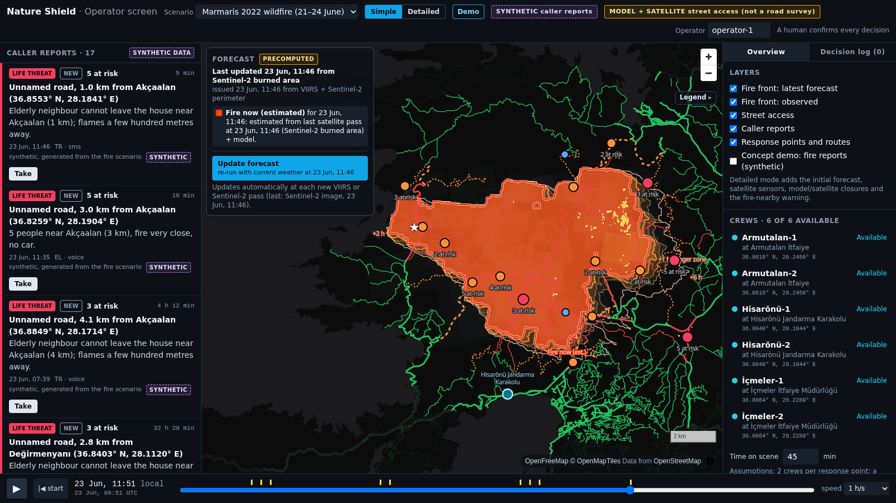 |
| after |  | 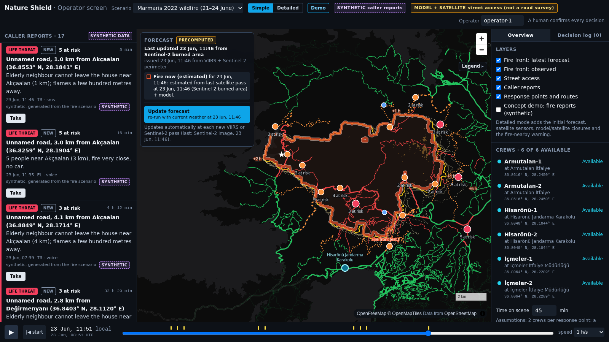 |

| 22 June 04:30 | 23 June 11:51 |
|---|---|
| 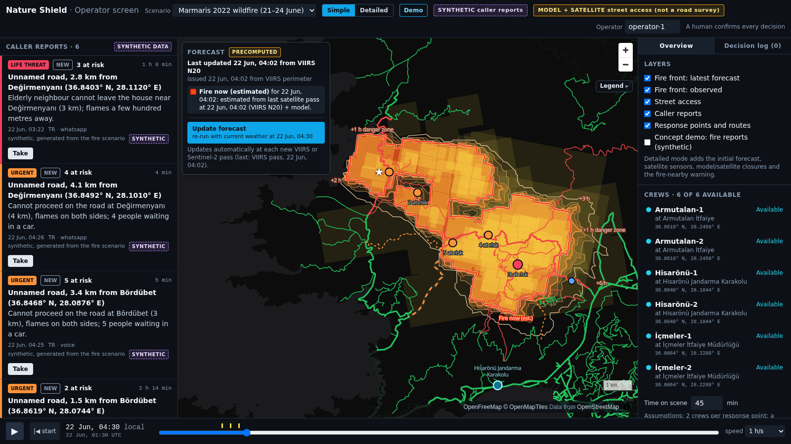 |  |

Older screenshots, side by side with Detailed (before "Fire now" was added):
[22 June 04:30](docs/simple_vs_detailed_0430.png), [23 June 11:51](docs/simple_vs_detailed_1151.png).
Legend opened: [docs/simple_legend_open.png](docs/simple_legend_open.png).

## What the labels mean

| Label on screen | Meaning |
|---|---|
| **REAL DATA** | Measured or observed: satellite detections, OpenStreetMap geometry and station locations. |
| **MODEL OUTPUT** / **MODEL + SATELLITE** | Computed from real inputs; an estimate, not a survey. The forecast contours are model output. Street access in the sample scenario is MODEL + SATELLITE: a street is **closed** (solid red) once a satellite has seen fire on it, and is a **forecast closure** (orange dashed) when only the forecast in force reaches it. |
| **SYNTHETIC** | Invented sample data written for the demo so that a layer can be shown before the real tool's export exists. In the sample scenario every caller report is synthetic. No real caller data is in this repository. |

## What is real and what is synthetic

| Layer | File | Status |
|---|---|---|
| Fire front | `public/scenarios/marmaris_2022/firefront.geojson` | **Real observations + model forecasts.** Fire-model contours (the initial 8 / 20 / 40 h forecast and 15 forecast updates of +30 min / +1 / +2 / +3 / +6 h) and satellite observations (NASA FIRMS VIIRS and MODIS, Copernicus Sentinel-3 SLSTR, Sentinel-2), exported by the fire tool. |
| Street access | `public/scenarios/marmaris_2022/street_access.geojson` | **Model + satellite.** Real OpenStreetMap streets (© OpenStreetMap contributors, ODbL). A street is `blocked` from its `valid_at` when the forecast in force reaches it (forecast closure: the fire repository's road-closure calculation on that forecast's P ≥ 50 % contour, 150 m safety buffer) **or** a satellite saw fire on it (observed closure) (a VIIRS 375 m pixel footprint crosses it, or the Sentinel-2 flame front or burned area is within 150 m, or MODIS/SLSTR 1 km pixels cover it in two separate overpasses between 30 minutes and 6 hours apart and a VIIRS or Sentinel-2 detection made by then lies within 1 km of it: "satellite (repeated MODIS/SLSTR)")"). A single MODIS or SLSTR pixel does not close a street; it raises a "fire nearby (satellite)" warning, drawn as an amber halo. Not a road survey: no width was measured. |
| Caller reports | `public/scenarios/marmaris_2022/caller_reports.json` | **SYNTHETIC.** Invented reports generated from the fire scenario: placed on streets that close (by forecast or satellite) and timed around that closure, so calls increase as the fire grows. Their urgency comes from a rule in the build script, not from the voice agent; cards say "synthetic, generated from the fire scenario". They never enter any measurement. |

Every synthetic record carries `"synthetic": true`, and each synthetic file has `"metadata": {"synthetic": true}`.
A file derived from the fire model has a `metadata.basis` starting with `fire_model` and may set
`metadata.label` (the sample's street file: `MODEL + SATELLITE`). The screen takes its labels from those flags, so they disappear by themselves when real files replace the samples.

## Data sources and licences

| Data | Source | Licence / terms |
|---|---|---|
| Hotspots (VIIRS 375 m, MODIS 1 km) in `firefront.geojson` | NASA FIRMS (LANCE / EOSDIS) standard-processing archive | NASA EOSDIS open data policy: free and open, no restrictions; acknowledgement requested. *We acknowledge the use of data from NASA's Fire Information for Resource Management System (FIRMS) (https://earthdata.nasa.gov/firms), part of NASA's Earth Science Data and Information System (ESDIS).* |
| Hotspots (SLSTR 1 km), flame front and burned area in `firefront.geojson` | Copernicus Sentinel-3 SLSTR and Sentinel-2 L2A, via Microsoft Planetary Computer | Copernicus Sentinel data: free, full and open access. Contains modified Copernicus Sentinel data (2022). |
| Forecast contours in `firefront.geojson`; street status in `street_access.geojson` | Nature Shield fire model (Rothermel, minimum travel time, Monte Carlo) | Model output of the project's fire tool. |
| Street geometry, station locations, place names (`street_access.geojson`, `responders.json`, `tools/osm/`) | OpenStreetMap, via the Overpass API | © OpenStreetMap contributors, Open Database Licence (ODbL) 1.0. Files derived from it stay under the ODbL. |
| Basemap (online, and the packaged copy in `public/basemap/`) | OpenFreeMap tiles, OpenMapTiles schema, OpenStreetMap data | © OpenStreetMap contributors (ODbL); © OpenMapTiles; tiles by OpenFreeMap. |
| Caller reports (`caller_reports.json`) | Written for this demo | Synthetic, CC0-1.0. |

Each record also carries its own `source`, `source_url`, `license` and `fetched_at`. Some `source_url` values
point at the fire tool's repository, which is private.

No licence has been chosen yet for the code in this repository.

## Run

Needs Node 20 or newer.

```bash
npm install
npm run dev          # http://localhost:5173
```

Other commands:

```bash
npm run validate     # check every data file against schemas/*.schema.json
npm run routes       # table: drive time from each response point to each caller
npm run build        # type-check and build into dist/
npm run preview      # serve dist/ on http://localhost:4173
```

The screen opens at 22 June 02:30 UTC (05:30 local): seven calls are in and crews can reach some of them.

**Demo scene:** the **Demo** button in the header, or `?demo=1`, opens 23 June 08:40 UTC with the Akçaalan
call reported at 08:35 UTC (`synthetic-call-016`) selected. Take → Confirm → Dispatch sends Armutalan-1 with an
ETA of 9 min; moving the clock on about 6 minutes cuts the route (Sentinel-2 flame front on the Marmaris–Datça
road) and the card offers the new route from where the vehicle stopped. Both are set in `public/scenarios/index.json`
(`initial`, `demo`).

Deep link to any other moment: `?t=2022-06-23T09:02:00Z&call=synthetic-call-005`
(`t` = UTC time, `call` = id of the report to select, `scenario` = scenario id).

### Basemap, online and offline

The basemap is the OpenFreeMap dark style, or the copy packaged in `public/basemap/` (10 MB: vector tiles for
zoom 0–14 over 27.85–28.45° E, 36.65–37.05° N, fonts, sprites, style):

- Once the offline package is stored on the device (see below), the packaged copy is used even online, so a slow
  network is not loaded with map tiles the device already has.
- Otherwise the online style is used if it answers within 3 seconds, else the packaged copy.
- With the packaged copy the map says "Packaged basemap (stored on this device, demo area only)"; outside that box
  the map is empty. The data layers are always local files.
- `?basemap=offline` forces the packaged copy (rehearse without unplugging the network), `?basemap=online` the
  online one.
- Rebuild or change the area: edit `BBOX` / `MAX_ZOOM` in `tools/fetch_basemap.mjs`, then
  `node tools/fetch_basemap.mjs` (it refuses to exceed 100 MB).
- Map data © OpenStreetMap contributors (ODbL), schema © OpenMapTiles, tiles by OpenFreeMap.

### Working without internet

The built site (`npm run build`, `npm run preview`, GitHub Pages) installs a service worker
([vite-plugin-pwa](https://vite-pwa-org.netlify.app/), config in `vite.config.ts`) that stores the page, the
scenario data and the packaged basemap (963 files, about 45 MB; GitHub Pages serves them compressed).

- **First visit:** the download starts only after the map has drawn what is on screen and the browser is idle, so
  on a slow network the visible map and the data come first. The header shows **✓ Offline ready** when it is
  done. After that the screen opens, reloads and routes crews with no network at all, at any deep link
  (`?demo=1`, `?t=…`).
- **New version:** a new deployment is downloaded in the background but does not take over an open page (that
  would mix the old page with the new data, and reloading by itself would lose open work). The page shows
  **New version available, tap to reload**; the new version is used from that tap, or the next time all tabs of
  the site are closed. The page also asks the network for `version.json` after loading and whenever its tab comes
  back to the front, so a tab left open on a phone notices a new deployment too.
- **Which version is running:** the Layers panel ends with "Version 36a4a31 · built …" (the commit). A phone that
  still shows an older behaviour is running an older stored copy: pages opened before the update notice existed
  (before 36a4a31) cannot show it, so close every tab of the site once (or clear the site's data) and reopen it.

Before a presentation: open the site once on the presenting laptop (and on each tablet) while online and wait for
**✓ Offline ready**. To check, switch the network off and reload. `npm run dev` does not use the service worker.

## Using the screen

- **Scenario** (top): picks an entry of `public/scenarios/index.json`.
- **Time bar** (bottom): play / pause, slider in 1-minute steps, speed. While the slider is dragged the thumb and
  the clock follow at once, the map follows several times a second, and route planning waits until it is
  released. During playback, touching the slider holds playback (the slider is the only clock while held); on
  release the map settles on the new time (within a second on a phone with a 4x slower CPU in our tests) and
  playback goes on from there. Playback draws at most about ten frames a second and, when the device is busy,
  skips straight to the current time instead of working through the frames it missed. Everything on the map is derived from the time shown, never built up from earlier states: after any
  number of jumps back and forth the screen equals a page opened at that time. Above the slider, small marks show every
  forecast load up to the time shown (yellow: automatic at a satellite pass; blue: by the operator). There is no
  text on the bar: hovering a mark (tapping it on a phone) opens a tooltip with the time and what happened. Marks
  closer than 16 px are merged into one, slightly wider mark ("3 passes"), and the tooltip lists each of them.

  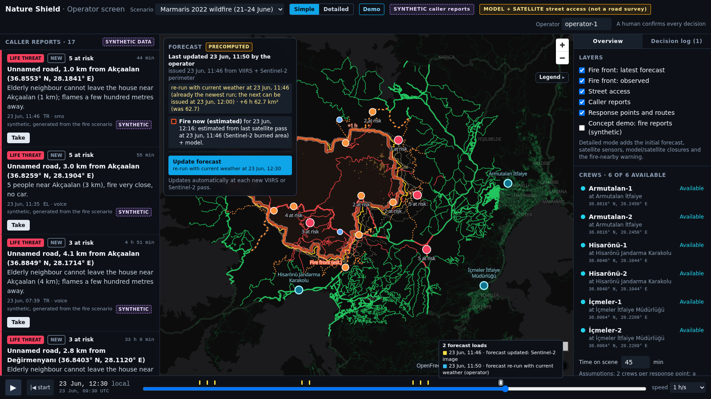
  On a phone (tap): [docs/c6_timebar_phone.png](docs/c6_timebar_phone.png).
  Everything follows this clock: reports appear at `reported_at`, satellite observations at `valid_at`,
  a forecast contour turns solid at `valid_at` and is dashed before that.
- **Map markers**: caller colour = urgency, ring = the operator's step; the label shows the people at risk.
  Labels that would overlap are hidden, the most urgent kept, and appear when you zoom in. Click anything on
  the map for a popup with its details and source.
- **Caller reports** (left): reports received so far, life threat first, then urgent, then routine; newest first
  within a class. Click a report (or its marker) to see the caller's own words, the reasons for the suggested
  urgency and the streets within 600 m with their access class; those streets are outlined in white on the map.
- **Street access**: green = open, orange = special access, red = blocked. In the sample, solid red = closed, fire
  seen there by a satellite; orange dashed = forecast closure, the forecast in force reaches the street but no
  satellite has seen fire there yet (crews are routed around both); amber halo = open but a 1 km
  satellite pixel with fire covers it. The right panel splits the blocked count into model / satellite / both,
  and the popup names the source ("Blocked since 22 Jun, 04:02 — satellite (VIIRS N20)"). Road Check classes are open
  (free width ≥ 3 m), special access (2 m to under 3 m) and blocked (under 2 m). A status can start at a time
  (`valid_at`): in the sample scenario a street turns orange dashed when the forecast in force reaches it and solid red
  when a satellite has seen fire on it. Click a street for details.
- **Right panel**: layer toggles, forecast and latest satellite pass, street counts, and which files are real.

## Forecast updates

### Automatic updates and "Update forecast"

The box at the top left of the map shows the forecast in force: "Last updated 04:02 from VIIRS N20", what it
started from, and "Fire now (estimated)".

- **Automatic:** at every new VIIRS pass or Sentinel-2 image, the forecast started from everything observed so
  far is loaded by itself, at the pass time, and a short notice appears on the map ("Forecast updated: new VIIRS
  pass"). Passes less than 20 minutes apart are one update.
- **Update forecast** always works. With no new observation it re-runs the forecast from the fire estimated now,
  with the weather from now on, and the result is labelled "re-run with current weather at 04:30" with the +6 h
  area against the previous run, so it is not mistaken for new information about the fire. Precomputed re-runs
  exist every 30 minutes; pressed again before the next one, the box says so. CONCEPT DEMO: with confirmed fire
  reports the button loads the forecast started from them ("with 3 confirmed reports").
- **Source:** the box says where the forecast comes from. **PRECOMPUTED**: a static site cannot run the model,
  so `tools/build_forecast_library.py` computes in advance every forecast that can be asked for, at ignition, at
  every new pass and every 30 minutes until the end of the scenario (127 forecasts, `forecast_library.json`,
  11 MB, 2 MB as served compressed). Each holds its contours every 30 minutes to 12 h and the area it started
  from. **LIVE MODEL** is for a model server on the demo laptop (`?forecast_api=http://localhost:8000`); not set up
  yet, see [docs/forecast_api.md](docs/forecast_api.md). If that server does not answer within 3 s the
  precomputed forecast is used and the box says so.
- **Forecast closures:** forecast closures (orange dashed) come from the forecasts in force over time. A forecast
  is in force from its load until the next one (automatic or by the operator); a street its contour reaches in
  that time closes, at the reach time or at the load time if that is later.
- **Rewind and log:** the operator's loads are in the decision log, and the ticks on the time bar mark every
  load up to the time shown. Moving the clock back before a load brings back the forecast that was in force
  then; loading another one there replaces the operator's later loads (the automatic ones stay, they follow the
  satellite passes).
- **No hindsight:** every precomputed forecast only uses observations acquired by its issue time, and an
  automatic update is loaded at its pass time, never earlier; the notice and the time-bar ticks only appear once
  the pass has happened. `tools/test_no_hindsight.py` checks the library; `tests/forecast.test.ts` checks that
  closures at a time never depend on later loads and that an automatic update only uses fire reports confirmed by
  then.

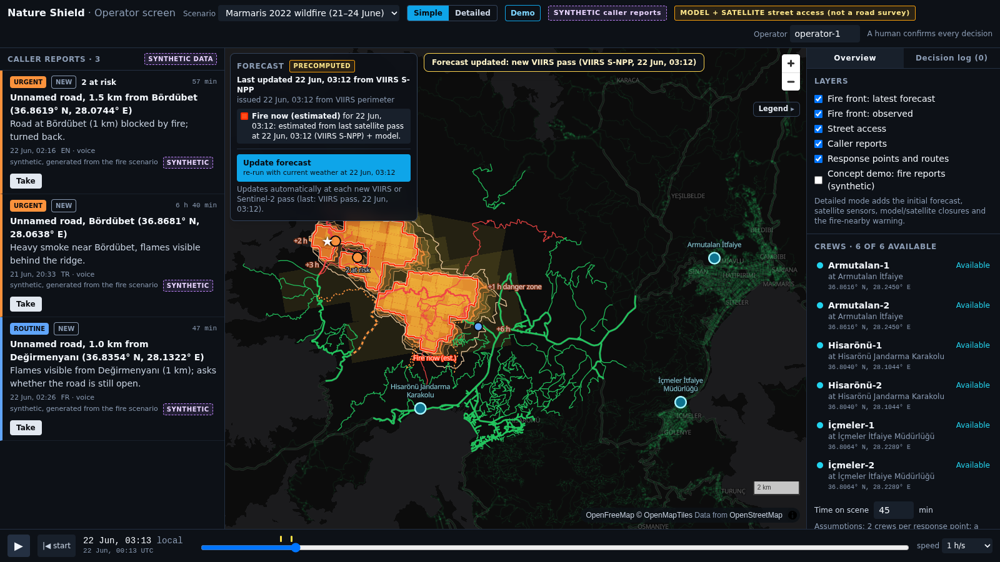

### The standing sequence

Street closures in `street_access.geojson`, the synthetic calls and the table below come from a fixed sequence:
a forecast at ignition and at every new VIIRS overpass or Sentinel-2 image (started from the union of everything
those sensors have seen so far; passes less than 20 minutes apart are one update), 15 in all.

**Horizons and contours.** Every forecast is a Monte Carlo ensemble of the fire repository's spread model; each run
gives an arrival-time map. The P ≥ 50 % contour at time h is where at least half of the runs have the fire by h.
It is stored every 30 minutes up to 12 hours, so the screen can show the fire at any time in between, and street
closures are timed to the half hour. The horizons offered by "Look ahead" and scored are **+30 minutes, +1, +2, +3 and +6 hours**. 12 hours is
longer than the longest gap between two fine-resolution passes (11.5 h), so the forecast in force always covers
the time shown.
The layer "Fire front: initial forecast (at ignition)" adds the single 8 / 20 / 40 h forecast made at ignition,
in blue, for comparison.

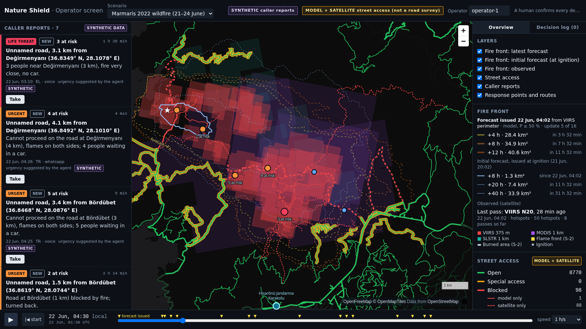

How the forecasts compare with later satellite data, updated forecasts against the single forecast made at
ignition. For each update and horizon, the FIRMS hotspots (VIIRS and MODIS) acquired between the issue time and
issue + horizon are counted. Overlapping updates count a hotspot once each, so the number of distinct hotspots is
given too. "New ground" means outside the area the update started from. The share of hotspots inside a forecast is
a recall and rewards large forecasts; the last column gives the other side: of the area a forecast adds beyond
its starting area, the share that any VIIRS or Sentinel-2 observation of the whole event saw burning.

| Updates | Horizon | Hotspot detections (distinct) | Inside updated | Inside one-shot | New ground: detections (distinct) | New ground inside updated | New ground inside one-shot | Forecast new area seen burning (updated / one-shot) |
|---|---:|---:|---:|---:|---:|---:|---:|---:|
| all 15 | +30 min | 26 (26) | 84.6 % | 0.0 % | 6 (6) | 33.3 % | 0.0 % | 39.5 % / 19.8 % |
| all 15 | +1 h | 383 (367) | 88.0 % | 5.5 % | 85 (80) | 45.9 % | 3.5 % | 41.6 % / 20.2 % |
| all 15 | +2 h | 531 (385) | 91.1 % | 7.9 % | 121 (95) | 61.2 % | 4.1 % | 42.1 % / 21.6 % |
| all 15 | +3 h | 554 (385) | 93.9 % | 9.2 % | 124 (96) | 72.6 % | 4.0 % | 41.1 % / 22.0 % |
| all 15 | +6 h | 589 (396) | 96.3 % | 12.7 % | 144 (107) | 84.7 % | 7.6 % | 35.1 % / 25.0 % |
| 1 started from the ignition point | +30 min | 0 (0) | – | – | 0 (0) | – | – | 100 % / – |
| 1 started from the ignition point | +1 h | 0 (0) | – | – | 0 (0) | – | – | 100 % / – |
| 1 started from the ignition point | +2 h | 0 (0) | – | – | 0 (0) | – | – | 100 % / 100 % |
| 1 started from the ignition point | +3 h | 0 (0) | – | – | 0 (0) | – | – | 100 % / 100 % |
| 1 started from the ignition point | +6 h | 11 (11) | 0.0 % | 0.0 % | 11 (11) | 0.0 % | 0.0 % | 100 % / 100 % |
| 14 started from a satellite perimeter | +30 min | 26 (26) | 84.6 % | 0.0 % | 6 (6) | 33.3 % | 0.0 % | 39.4 % / 19.8 % |
| 14 started from a satellite perimeter | +1 h | 383 (367) | 88.0 % | 5.5 % | 85 (80) | 45.9 % | 3.5 % | 41.5 % / 20.2 % |
| 14 started from a satellite perimeter | +2 h | 531 (385) | 91.1 % | 7.9 % | 121 (95) | 61.2 % | 4.1 % | 42.0 % / 21.2 % |
| 14 started from a satellite perimeter | +3 h | 554 (385) | 93.9 % | 9.2 % | 124 (96) | 72.6 % | 4.0 % | 40.9 % / 21.6 % |
| 14 started from a satellite perimeter | +6 h | 578 (385) | 98.1 % | 13.0 % | 133 (96) | 91.7 % | 8.3 % | 34.9 % / 24.1 % |

Reading it: started from the ignition point, the model contains none of the first hotspots (it stays far too
small on the first night). Started from a satellite perimeter, it contains most hotspots on new ground within a few
hours (46 % at +1 h, 73 % at +3 h, 92 % at +6 h), but only 35-42 % of the new area it forecasts was ever seen
burning: it over-predicts, and more so with the horizon. The single forecast made at ignition contains 3-8 % of
the new-ground hotspots.

**Caveats: in-sample parameters, hindcast weather, zero satellite latency.** Four model parameters
(r0_multiplier, gust fraction, wind-direction spread, length-to-breadth cap) were set on this same fire; the
weather is the archived Open-Meteo historical forecast, not the forecast available at the time; each update is
issued at the overpass minute, while real near-real-time data arrive hours later. This is a replay of one fire,
not a validation. Full table: [docs/forecast_skill.md](docs/forecast_skill.md).

The updates are computed by `tools/build_marmaris_scenario.py` with the fire repository's model, on its
reconstruction grid (forecasts stop at that grid's edge). The weather is the same Open-Meteo historical forecast
the fire repository caches, requested for 21-25 June (`tools/weather/marmaris_2022_open_meteo.json`; the fire
repository's copy ends on 23 June), so forecasts can be issued until the end of the scenario (24 June 04:00 local).
The model has no suppression, so late updates over-predict.

## Operator-confirmed fires and the in-browser model

**Add fire** (top bar) lets the operator put a fire reported by a field crew, a drone, a caller or another source
into the real scenario:

- Point, about 100 m and about 500 m: one point on the map; another click moves it there ("Click to place the fire;
  click again to move it"). Only when **drawn area** is picked does each click add a corner ("Click to add corners";
  two corners make a fire line 60 m wide, three or more the polygon). Going back from the drawn area to a size keeps
  the first corner as the fire's place and clears the others, and the box says so. The map previews exactly what
  Confirm adds. The box also asks for the source, when it was seen (now, or up to 2 hours earlier) and a short note. **Confirm** adds it to the decision log and to the map, with its own orange area, a white dashed edge
  and a label: "Operator-confirmed fire · crew · 22:40". Drag the label to move the fire; its ✕ deletes it. Moves
  and deletions are logged too.
- Each change recomputes the forecast **in this browser**: from the fire the forecast in force estimates (built
  from the last satellite edge; the model runs from the time of that estimate's half-hour step, with the weather
  from then) plus every operator-confirmed fire, burning from the time it was seen. The forecast box then says
  **LIVE IN BROWSER** and "Last updated 22:41 · satellite 21:05 + 1 operator-confirmed fire"; fire now, the
  look-ahead line, the forecast closures, the route warnings and the crews' routes follow it. A fire added inside
  the area the forecast already had by +6 h cannot change that area: the box says "already inside the +6 h forecast
  area; changes timing nearby" instead of "+6 h 32.7 km² (was 32.7)".
- Deleting a fire recomputes without it ("+ model · operator-confirmed fire deleted", LIVE IN BROWSER); only
  without the browser model does the screen go back to the precomputed forecast. A browser forecast remembers which
  fire versions it was made from, so the next one never starts from a forecast that still holds a fire since
  moved or deleted.
- **Update forecast** uses the browser model too (re-run with the current weather); the precomputed forecasts stay
  as the fallback (and for the CONCEPT DEMO reports, whose forecasts were precomputed). A confirmed CONCEPT DEMO
  report can be added the same way ("Add as confirmed fire").
- Rules: like everything on the screen an operator fire follows the clock. It is not shown before the moment it was
  added, and acting at an earlier time drops later edits. Operator fires never enter the overlap (skill) table. At
  the next satellite pass the automatic update starts from the satellite edge alone; press Update forecast to bring
  the operator fires back in.
- Why "the fire estimated now" and not the last satellite edge alone: when the last pass is hours old, starting from
  its edge at the current time would shrink the fire. The estimate is itself derived from that edge by the model.

**The model in the browser** (`src/spread/`): the fire repository's simplified Rothermel spread rate, the Anderson
length-to-breadth ellipse, the 16-neighbour Minimum Travel Time and the Monte Carlo ensemble (40 runs), ported to
TypeScript and run in a Web Worker. Its inputs come from `tools/export_spread_grid.py`: the model grid (60 m,
157 × 270 cells, UTM 35N) with the WorldCover class, slope and aspect per cell (`spread_grid.bin.gz`, 146 kB), and
the fuel parameters, settings and hourly weather (`spread_model.json`); both are in the offline package. An update
takes 0.1–0.8 s on a laptop (a few seconds on a phone). A newer change cancels a computation still running
(`LatestRequest`, checked between Monte Carlo runs).

**Outlines** of a browser forecast are cleaned and smoothed like the precomputed ones (whose contours get
`buffer(+60 m).buffer(-60 m).simplify(30 m)` in Python): a one-cell closing, holes under 12 cells filled, parts
under 3 cells dropped (never an operator-confirmed fire), marching squares over the cell centres (45° steps
instead of 60 m stairs; rings never cross), then two rounds of Chaikin. Areas and street reach still come from the
cells. On the 49 masks of the validation cases: no crossing segments, IoU 1.000 with the cleaned cells, 0.986 with
the raw cells, 0.968 with the library's Python-smoothed start. The front band of both kinds of forecast is drawn
opaque (a see-through wide line drew its overlaps at bends twice, as bright wedges), with its light edges under it.

| Browser forecast, before | After (smoothed outlines, opaque band) |
|---|---|
| 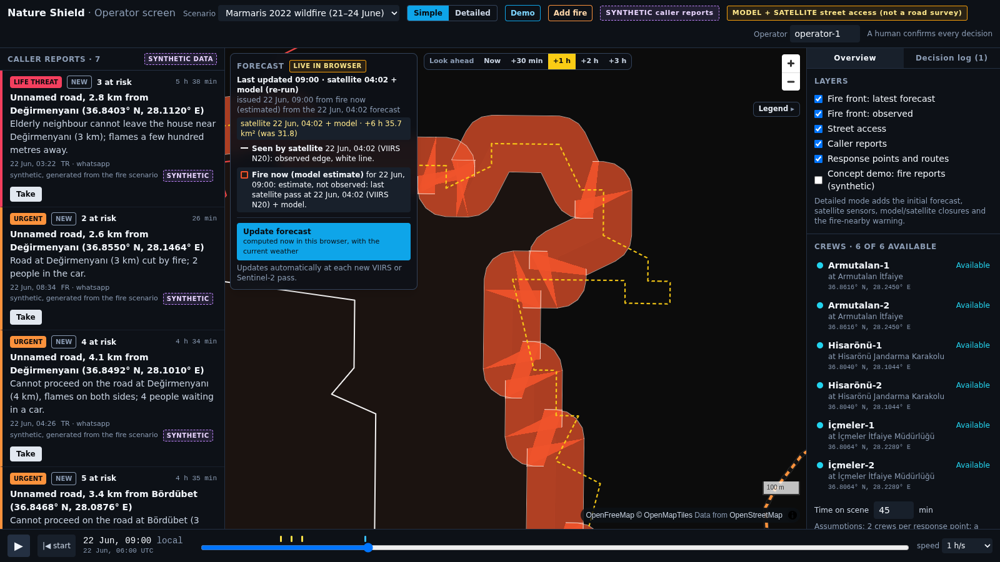 | 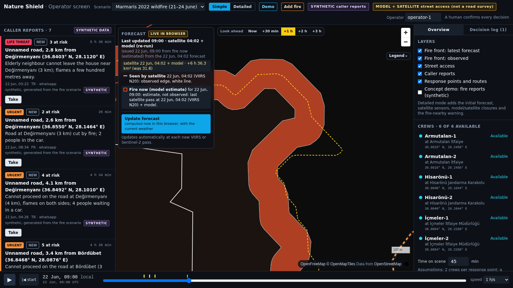 |
| 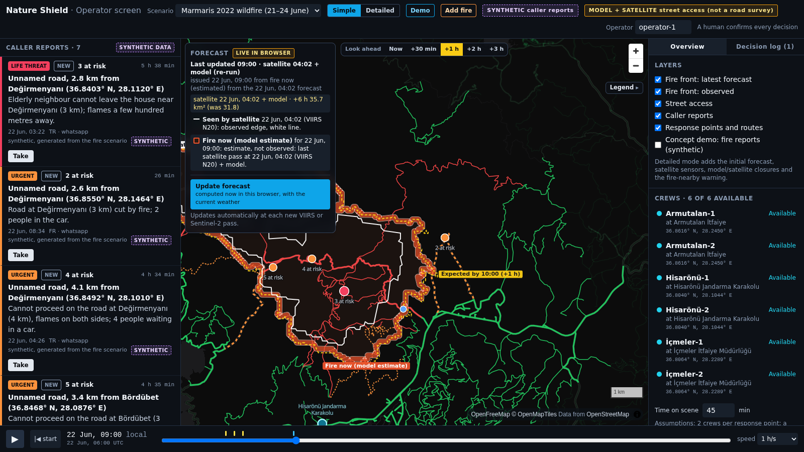 |  |

**Checked against the Python model** (`tools/compare_spread.py` writes the reference cases, `tests/spread.test.ts`
compares; IoU = intersection over union of the cells):

| Case | One run without perturbation: IoU (worst horizon) | 40-run ensemble, P ≥ 50 %: IoU at 30 min / 1 / 2 / 3 / 6 / 12 h |
|---|---:|---|
| ignition (ignition point) | 1.000 | 1.000 / 1.000 / 0.973 / 0.960 / 0.855 / 0.766 |
| observation 21 Jun 23:22 (library) | 1.000 | 0.984 / 0.979 / 0.962 / 0.943 / 0.941 / 0.909 |
| observation 22 Jun 01:02 (library) | 1.000 | 0.990 / 0.986 / 0.976 / 0.964 / 0.950 / 0.920 |
| re-run 22 Jun 06:00, chained (library) | 0.999 | 0.996 / 0.993 / 0.986 / 0.979 / 0.962 / 0.944 |
| observation 22 Jun 10:43 (library) | 1.000 | 0.988 / 0.986 / 0.978 / 0.971 / 0.970 / 0.952 |
| observation 23 Jun 08:46 (library) | 1.000 | 0.996 / 0.990 / 0.986 / 0.981 / 0.971 / 0.947 |
| 23 Jun 09:00, perimeter + 500 m operator fire | 1.000 | 0.996 / 0.989 / 0.986 / 0.981 / 0.967 / 0.942 |

A single run matches the Python code cell by cell. The ensembles draw their random numbers differently (NumPy's
generator is not reproduced), so they agree statistically: six of seven cases at IoU ≥ 0.9 at every horizon. The
seventh is the tiny fire at ignition, where 40 runs are noisy: two browser ensembles with different seeds agree
only to 0.80 / 0.74 at 6 / 12 h themselves, and with 400 runs the browser and Python agree to 0.991 / 0.972.

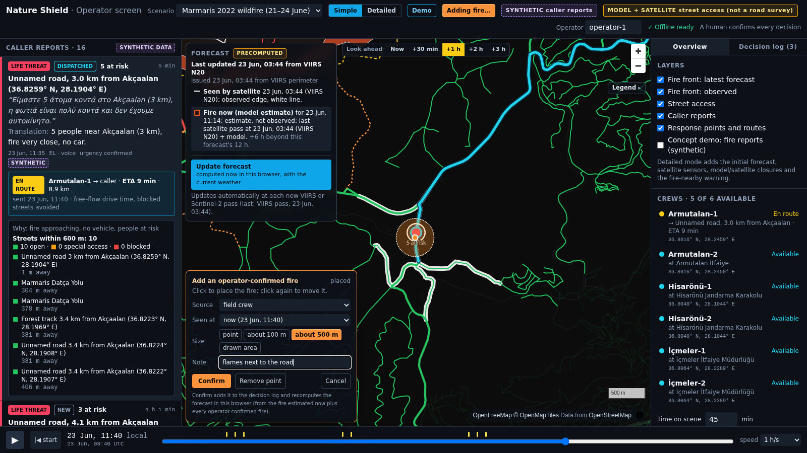

| Before | After (the fire on the route: "Route may be cut by fire") |
|---|---|
| 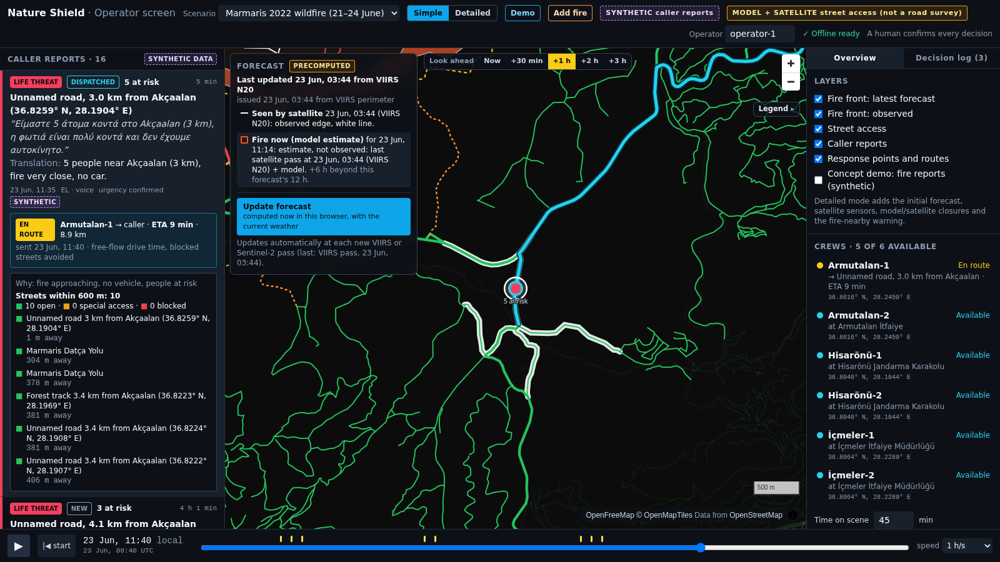 | 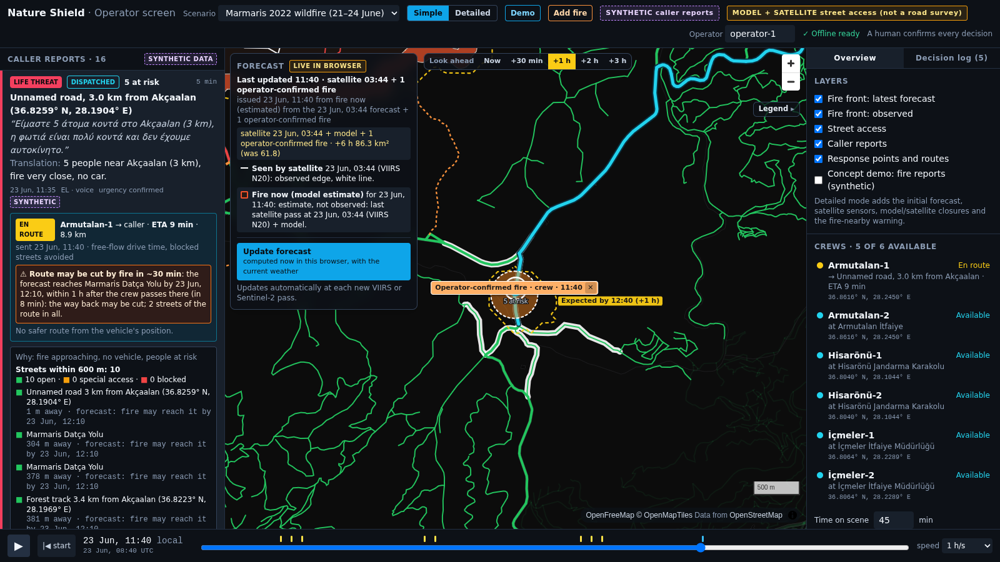 |

| Point mode: one point, moved by each click | Drawn area: each click a corner | Back to a size: the first corner stays |
|---|---|---|
| 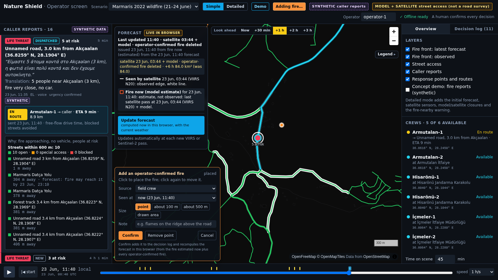 | 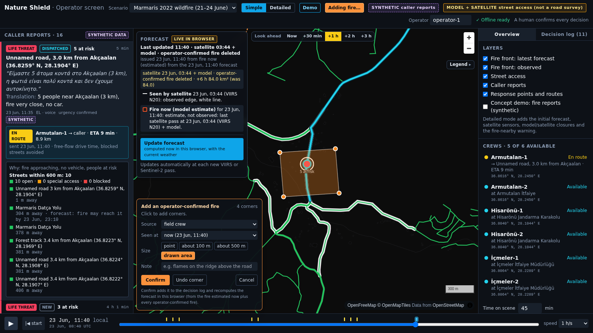 | 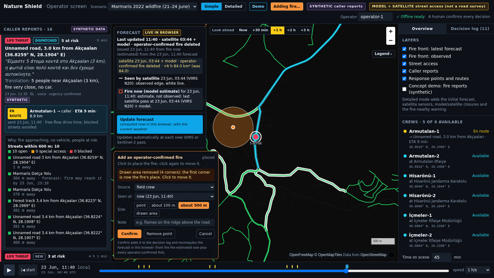 |

Inside the +6 h area: [docs/f_inside.png](docs/f_inside.png); the drawn area added: [docs/f_drawn_after.png](docs/f_drawn_after.png).
Decision log: [docs/f_log.png](docs/f_log.png); phone: [dialog](docs/f_phone_dialog.png), [after](docs/f_phone_after.png).

## Fire reports from people (CONCEPT DEMO)

**CONCEPT DEMO · synthetic reports derived from later satellite passes.** Off by default; turn on "Concept demo:
fire reports (synthetic)" in the layer list, or open `?concept=1&t=2022-06-21T22:00:00Z`. While it is on, the label
is in the header, on the map and in the panel.

Why: on the first night the satellites gave only 1 km pixels for six hours and the model, started from the
ignition point, stayed far too small (the first VIIRS pass, at 23:22 UTC, saw fire 8 km east). Calls saying "I see
flames here" could start a better forecast earlier. To show this without circular reasoning, the calls are not made
from the model (`tools/build_concept_reports.py`, fixed seed):

- **Reports:** every first-night VIIRS pass sees fire on new ground. For each such place, 1–3 callers report it
  before the pass: at an assumed fire arrival 30–150 min earlier, 300–800 m from where the satellite saw it. 25 %
  of the reports are false (no fire there, ever), including one convincing pair (two callers see "flames" at a
  burning skip). Some numbers call twice. 21 reports in all. Which reports are false is never shown on the screen.
- **Clustering and confidence:** in time order, a report joins a cluster within 1 km and 30 min. Confidence is a
  noisy-OR, `P = 1 − Π(1 − wᵢ)`, one weight per independent source, w = statement (flames 0.6, fire near 0.4,
  smoke 0.15, hearsay 0.05) × location quality (GPS 1.0, address 0.7, "near X" 0.4) × observer distance (on site
  1.0, < 500 m 0.8, far 0.4) × independence (same number again: 0). One source never counts more than 0.5.
- **Candidates:** a cluster with two independent sources and P ≥ 0.5 is a candidate, drawn as a dashed purple
  disc, "REPORTED (unconfirmed)", whose radius is the location uncertainty. Single reports are small points.
- **Confirm:** a candidate never enters the model by itself. The operator's **Confirm** marks it (solid disc,
  decision log) and the next **Update forecast** starts from the perimeter plus a disc for each confirmed candidate.
  These forecasts are precomputed for every set of candidates the night can have (137); the forecast box says
  "with 3 confirmed reports (CONCEPT DEMO)".
- **Score, after the fact:** once the next VIIRS pass has happened, the panel compares the forecasts issued before
  it: without reports, with the true candidates only, and with every candidate (the false one included).

| Forecast issued (UTC) | vs VIIRS pass | Variant | New fire inside | Area | Added area seen burning |
|---|---|---|---:|---:|---:|
| 21 Jun 23:00 | 23:22 | without reports | 0 % | 0.92 km² | 100 % |
| 21 Jun 23:00 | 23:22 | with the true reports | 5.0 % | 1.82 km² | 95.3 % |
| 21 Jun 23:00 | 23:22 | with every candidate (1 false) | 5.0 % | 1.99 km² | 87.0 % |
| 21 Jun 23:22 | 00:12 | without reports | 66.7 % | 15.3 km² | 88.0 % |
| 21 Jun 23:22 | 00:12 | with the true reports | 86.7 % | 16.1 km² | 87.8 % |
| 21 Jun 23:22 | 00:12 | with every candidate (1 false) | 86.7 % | 16.3 km² | 83.2 % |

Reading it: before the first VIIRS pass the reports put a little of the new fire inside the forecast (5 % instead of
none), but a model started from a few small discs is still far too small for that night. After the pass they add
20 points. The false candidate adds area that never burned. Full table: [docs/concept_reports.md](docs/concept_reports.md).
This is an **upper bound** (real callers are fewer, later and less precise) and it is **excluded from the overlap
table** above. `tools/test_no_hindsight.py` checks that clustering only uses reports received by each time and that a
forecast only uses candidates known by its issue time.

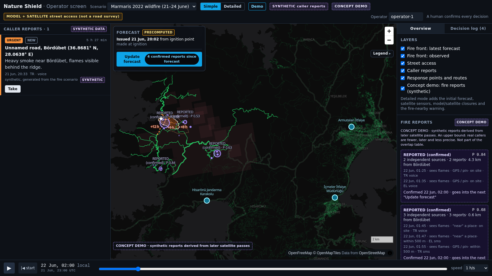
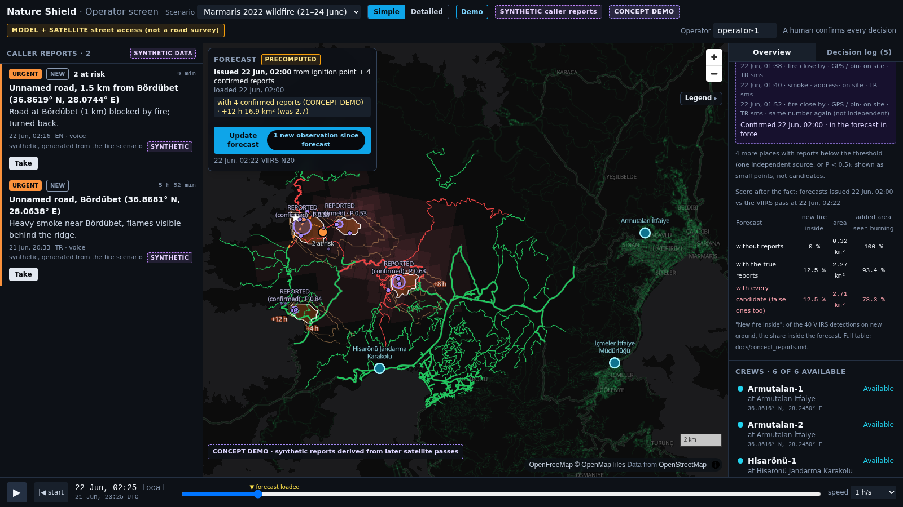

## "Is the fire still there?" (MOCK)

A reported fire is only true for a while. Each piece of evidence fades: a call has a **half-life of 40 minutes**, a
crew sighting 3 hours. Below P 0.2 the place is **EXPIRED** and has to be confirmed again before it can go into a
forecast. On a candidate the operator can **Ask for confirmation**:

1. **Target:** the first request goes to the nearest crew within 10 km, by radio; the next one goes to a person who
   reported the place, on site first, in their language and channel. People in danger are not called back for
   this.
2. **Answer:** an answer can only be counted once it has arrived.
   - "yes" adds or refreshes a source (crew 0.9, caller on site 0.6, further away 0.3).
   - "no" multiplies the confidence by 0.2 from someone on site, 0.7 from further away.
   - No answer within 15 minutes changes nothing.
3. **Record:** every request goes into the decision log.

**This is a mock:** nothing is sent. The answers come from `mockAnswer()` in `src/reports.ts`: a crew answers
from the place in ~8–11 min, a caller in ~4–7 min; where the synthetic scenario had fire the answer is "yes"
(a caller sometimes does not answer), where it had none it is "no". The screen marks each request **MOCK**.

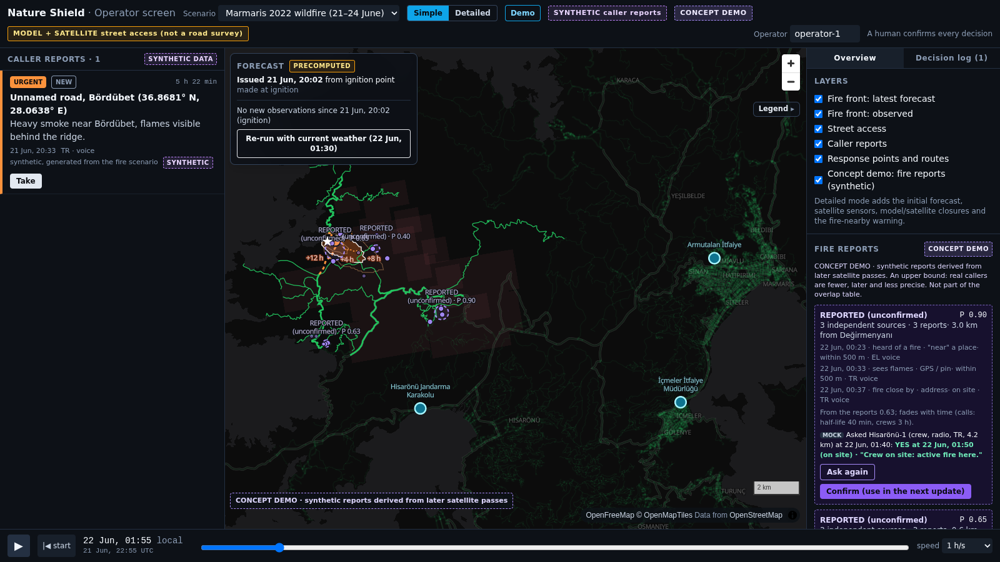
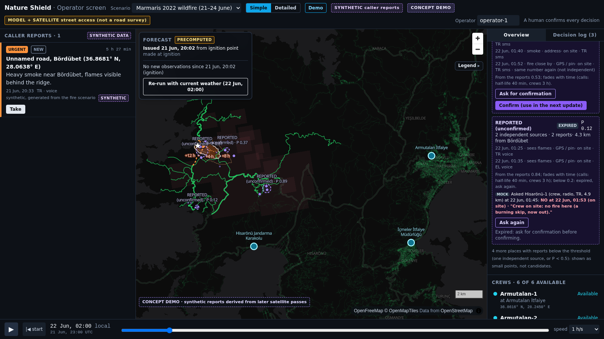

### Connecting the Greek team's voice assistant

The screen and the voice assistant need to agree on three records (JSON Schema, with an example each in
`schemas/examples/`; `npm run validate` checks them):

| Record | Who writes it | Fields |
|---|---|---|
| [`FireReport`](schemas/fire_report.schema.json) | voice intake, a crew app, a drone | `id`, `kind` (caller / drone / crew), `observed_at`, `place` {`lon`, `lat`, `uncertainty_m`}, `statement_class`, `location_quality`, `observer_distance`, `source_ref` (hashed number), `language`, `channel`, `confidence` |
| [`ConfirmationRequest`](schemas/confirmation_request.schema.json) | operator screen | `id`, `report_id`, `target` {`kind`: crew / caller, `ref`}, `channel` (sms / whatsapp / voice / radio), `language`, `question_code`, `sent_at`, `expires_at` |
| [`ConfirmationResponse`](schemas/confirmation_response.schema.json) | voice assistant | `request_id`, `answer` (yes / no / unknown), `answered_at`, `place` (optional), `free_text` |

How it would run:

1. **Intake:** the voice assistant classifies what the caller says into `statement_class`, `location_quality`
   and `observer_distance`. It never sends the phone number, only `source_ref` = a salted SHA-256 of it, so
   repeat calls are recognised without storing the number.
2. **Asking:** for a `ConfirmationRequest` it only maps `question_code` to a template in Turkish, Greek, English
   or German, places the call or message on `channel`, and maps the reply to yes / no / unknown.
3. **The relay:** a static site cannot receive messages, so a small relay is needed between the two. That is
   the same localhost FastAPI as the forecast server ([docs/forecast_api.md](docs/forecast_api.md)): the
   screen POSTs requests to it and polls it for responses and new reports. For Athens the mock stands in for it.
4. **Consent:** under GDPR / KVKK the caller must have agreed to be contacted again (`consent` in the request).
   Only hashed numbers leave the voice assistant.

## Crews

Each response point has **two crews** (an assumption, stated on screen), e.g. Armutalan-1 and Armutalan-2.
A crew goes **available → en route → on scene → returning → available**; it stays on scene for 45 minutes by
default (adjustable in the Crews section, logged; applies to crews sent afterwards) and then drives back.

- **Dispatch** sends the nearest free crew. With the report card selected, the suggested crew is shown with its
  ETA and every other crew is in a list with its own ETA: available and returning crews freely, crews on their
  way to another incident marked ⚠ ("Reassign … here"), which the operator has to pick explicitly.
- A **vehicle icon** moves along the route with the time slider; the card and the icon count the ETA down.
- If a street on the route becomes blocked while the crew is driving, the vehicle **stops where it is**, the card
  says which street cut the route and offers a **new route from the vehicle's position**.
- **Reassign**: a crew en route can be redirected to another waiting incident. The incident it leaves becomes
  **UNASSIGNED**, moves to the top of the list and shows a warning.
- The **Crews** section lists each crew's status, position and incident; click (or tap) a crew to move the map to it.
- Every step (dispatch, reassign, the incident left unassigned, re-route, setting change) is in the decision log.
- Crews and missions live in the page; reloading clears them. Moving the time slider back undoes nothing:
  positions and statuses are recomputed for the time shown.

| Suggested crew and candidates | Vehicle en route with ETA | Route cut, new route from the vehicle |
|---|---|---|
| 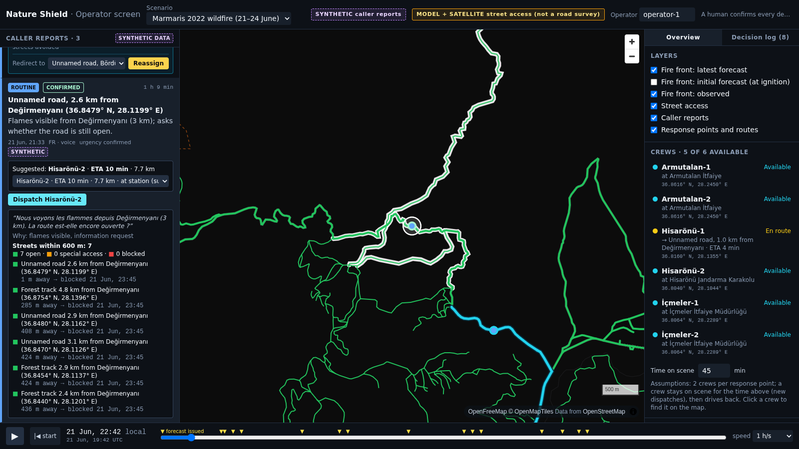 | 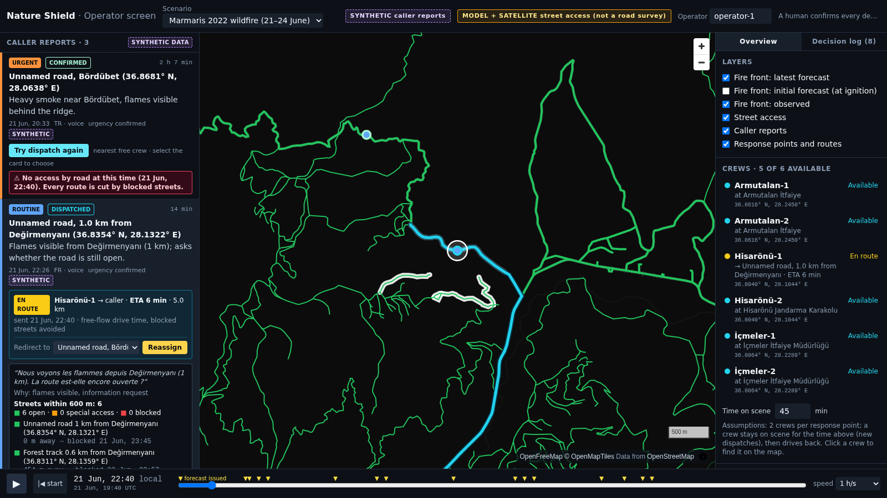 | 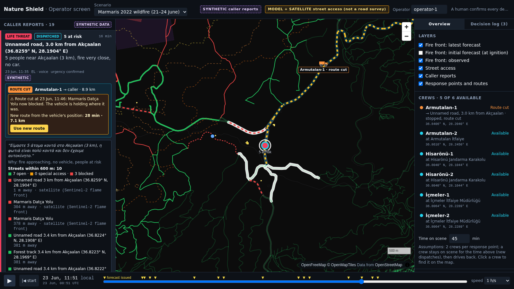 |

More: [Crews panel](docs/crews_1_crews_panel.png), [unassigned incident](docs/crews_4_unassigned.png),
[decision log](docs/crews_5_decision_log.png), [returning crew, map on it](docs/crews_6_returning_focus.png),
[phone: crews](docs/crews_8_phone_crews.png), [phone: crew tapped](docs/crews_9_phone_crew_focus.png).

## Screen sizes

- **1600 px and wider:** reports on the left, layers, crews and the decision log on the right.
- **1280–1599 px:** the same two panels, narrower (300 and 260 px), so the map keeps at least 55 % of the width.
- **768–1279 px (tablets, small laptops):** one panel on the left with three tabs (Reports, Layers & crews, Log);
  the map keeps 57–68 % of the width and the header wraps to two lines instead of being cut off. Selecting a
  caller on the map opens the Reports tab.
- **Below 768 px:** the phone layout below.

## On a phone

Below 768 px the map fills the screen and starts on the fire. The reports, the layer panel and the decision
log open from the bottom as a drawer with three tabs (**Reports / Layers / Decision log**); tap the open tab
to close it. The time bar stays fixed at the bottom with touch-sized controls. Tapping a report card selects
it and moves the map to the caller, in the part of the map the drawer does not cover. Scenario and operator
name are in the Layers tab. The desktop layout is unchanged.

| iPhone 390 × 844 | Reports | Card tapped | Layers | Decision log |
|---|---|---|---|---|
| 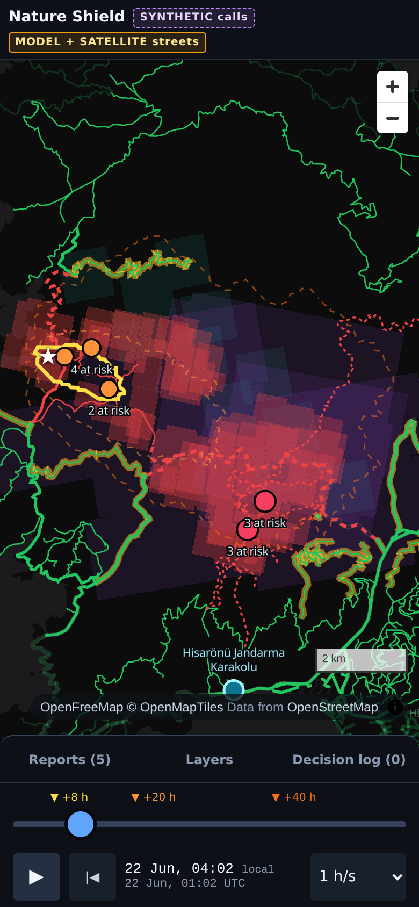 | 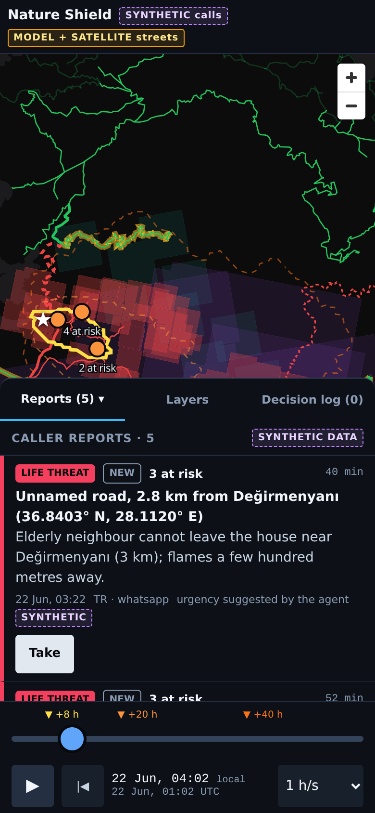 | 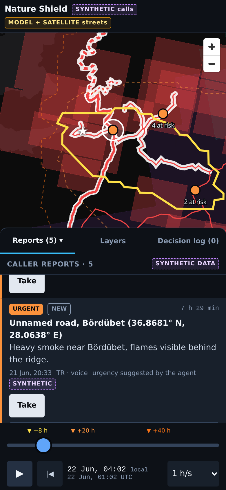 | 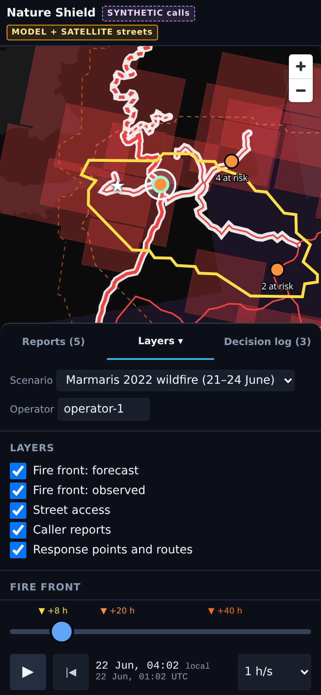 | 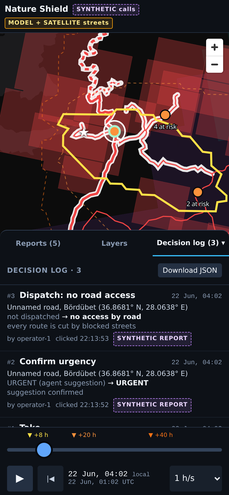 |

Held sideways (height of 500 px or less) the header is one line with the three tabs in it, the time bar is a
single thin row, and the tabs open a panel from the right that never covers more than half of the map.
Rotating the phone switches between the two layouts without reloading.

| Landscape 844 × 390 | Reports panel | Card tapped |
|---|---|---|
| 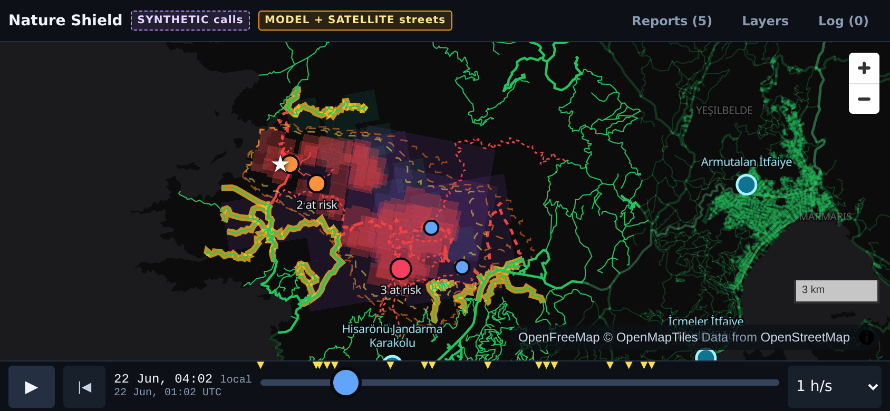 | 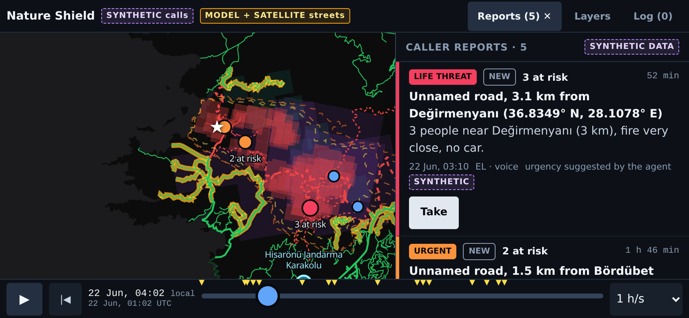 | 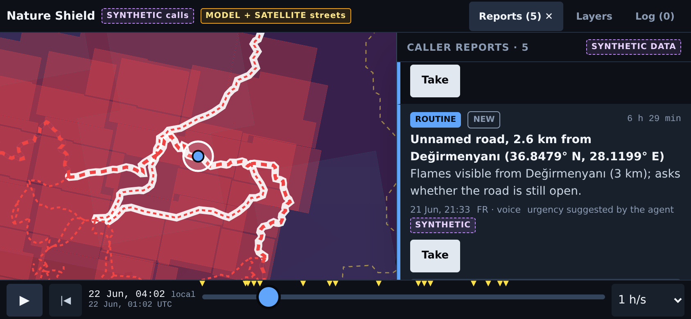 |

Landscape 800 × 360: [map](docs/phone_landscape_800x360_1_map.png), [reports](docs/phone_landscape_800x360_2_reports.png),
[card tapped](docs/phone_landscape_800x360_3_card_tapped.png), [layers](docs/phone_landscape_800x360_4_layers.png).

Android 360 × 800: [map](docs/phone_android_360x800_1_map.png), [reports](docs/phone_android_360x800_2_reports.png),
[card tapped](docs/phone_android_360x800_3_card_tapped.png), [layers](docs/phone_android_360x800_4_layers.png),
[decision log](docs/phone_android_360x800_5_log.png).

## Operator actions and the decision log

Each report card walks through three steps; nothing happens without a click.

1. **Take**: the operator picks the report up.
2. **Confirm urgency**: the agent's suggestion is preselected and can be changed before confirming.
   The list re-sorts on the confirmed urgency; the report keeps the agent's original suggestion.
3. **Dispatch**: the fastest crew is routed to the caller (see below).

The step reached is shown on the card and on the map marker (ring colour and label). Every click is written
to the **Decision log** tab on the right: scenario time, wall-clock time, operator (name field in the header),
the previous and the new value. **Download JSON** saves the log
(`{"record": "DecisionLog", "scenario": ..., "decisions": [...]}`); decisions on synthetic reports carry
`"synthetic_report": true`. The log lives in the page: reloading or switching scenario clears it.

## Crew routing

- **Response points** come from `responders.json`. In the sample they are three real OpenStreetMap locations:
  İçmeler İtfaiye Müdürlüğü and Armutalan İtfaiye (fire stations) and Hisarönü Jandarma Karakolu.
  That a crew is available at each of them is an assumption of the demo.
- **Dispatch** computes, on the scenario's street network, the fastest drive from any response point to the
  caller's street that avoids every street blocked at the current scenario time, draws it and shows the drive
  time and distance. If the caller's own street is blocked, the route ends at its nearest reachable end and the
  card says how far away the crew stops.
- If no response point can reach the caller, the card shows **"No access by road at this time"** and the
  attempt is logged. "Try dispatch again" repeats it at the current time.
- When the clock moves on and a street on a dispatched route becomes blocked, the route turns dashed amber
  and the card warns **"Route cut"** with the street; it offers a new route ("Use new route") or says there is
  no access.
- **Route safety.** Before and after dispatch the route is checked against the forecast in force: for each street
  the crew enters at the dispatch time plus its minutes along the route, and the forecast says when the fire may
  reach that street (P ≥ 50 %, 150 m safety buffer, to the half hour). If that is before the crew gets there, or
  within 1 or 2 hours after it passes (the +1 / +2 h zones at that time), the card warns **"Route may be cut by
  fire in ~X min"**, with the street and when. The screen then looks for a route that avoids every street the
  forecast reaches within the drive time plus 2 hours and still brings the crew as close to the caller; if one
  exists the card offers it ("Safer route: ETA 7 min (+2 min)", **Send via safer route**, or **Use safer route**
  for a crew already on its way), otherwise it says there is none. The screen draws only one or two forecast
  lines, but the route checks do not use the drawn lines: they use each street's reach time from the forecast's
  arrival-time contours (every 30 minutes, so to the half hour, with the 150 m buffer). Only the forecast in force is used: a cut that
  comes from a later satellite pass is not foreseen (the demo call is such a case: the route is cut at 08:46 by a
  new Sentinel-2 image). `tests/routeRisk.test.ts` checks every call at five times: each warning comes from the
  forecast in force; each "before the crew gets there" warning comes true at the warned minute when nothing new
  arrives first (42 of 42); a safer route is never riskier and never stops further from the caller.

  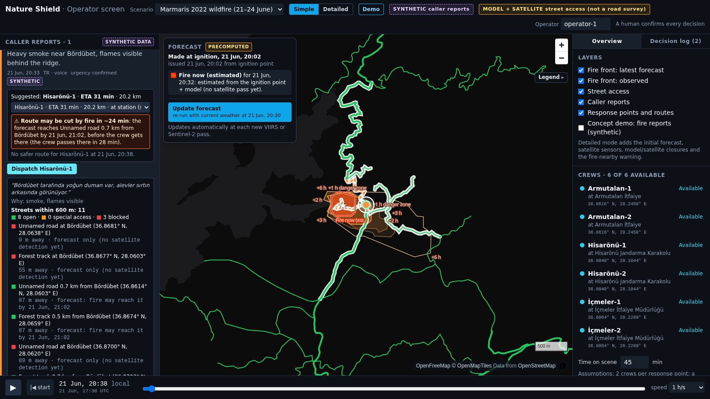
  Safer route offered: [docs/c5_route_safer.png](docs/c5_route_safer.png).
- Drive times are free-flow: road-class speeds as in the fire repository's evacuation settings (trunk 70,
  secondary 50, tertiary 40, residential and unclassified 30 km/h), plus our own 20 km/h for service roads and
  15 km/h for forest tracks. One-way restrictions, turn-out time and traffic are ignored.
- `npm run routes` prints the drive time from every response point to every caller at the time of the call,
  using the same routing code as the screen. In the sample most callers are 7–45 minutes from the nearest
  point. Two are about 95 minutes away because closures block the direct road and the only way in
  is 16 km of forest tracks; the route line on the card shows the forest-track kilometres.
- Routing needs `u`, `v` (junction node ids) on the street features and a connected network; without
  `responders.json` the Dispatch button is disabled.

## Dropping in the Greek team's files

Only data files change; no code.

1. **Voice intake → `caller_reports.json`**
   `{"metadata": {"record": "CallerReport"}, "records": [ ... ]}`, each record following
   [`schemas/caller_report.schema.json`](schemas/caller_report.schema.json).
2. **Road Check → `street_access.geojson`**
   A GeoJSON FeatureCollection of LineStrings (EPSG:4326, `[lon, lat]`), each feature's `properties` following
   [`schemas/street_access.schema.json`](schemas/street_access.schema.json).
3. Put both in `public/scenarios/<scenario id>/`, overwriting the samples (or add a new folder and a new entry in
   `public/scenarios/index.json` with its `center`, `zoom`, `start`, `end` and the three file paths).
4. Leave out `"synthetic": true` in real files.
5. Run `npm run validate`. It prints the first problems per record and exits non-zero if a file does not match.

The fire front comes from the fire repository:
`python -m fireproj.export_firefront --event marmaris_2022`, then copy `exports/marmaris_2022_firefront.geojson`
to `public/scenarios/marmaris_2022/firefront.geojson` ([`schemas/fire_front.schema.json`](schemas/fire_front.schema.json)).

### The three records

All three share the same provenance fields: `schema_version`, `source`, `source_url`, `license`, `fetched_at`,
`observed_at`, `received_at` (UTC, ISO 8601). Extra fields are allowed and ignored.

| Record | Required fields | Optional |
|---|---|---|
| `CallerReport` | `id`, `reported_at`, `place` (`lon`, `lat`, `label`), `language` (`el`/`tr`/`en`/`fr`), `urgency` (`life_threat`/`urgent`/`routine`), `urgency_reasons[]`, `hazard`, `people_at_risk`, `summary`, `confirmed_by_operator` | `summary_en` (English translation, shown under the caller's words as "Translation: …" when `language` is not `en`; the synthetic data always has it), `channel` |
| `StreetAccess` | `id`, `osm_way_id`, `status` (`open`/`special_access`/`blocked`), `confirmed_by_operator`; with `basis: "imagery"` also `free_width_m` and `imagery_date` | `valid_at` + `status_before` (status that starts at a time), `basis` (`imagery`/`fire_model`/`satellite`/`fire_model_and_satellite`/`operator`), `reason`, per-source closure: `blocked_by`, `first_blocked_by`, `model_blocked_at`, `satellite_blocked_at`, `satellite_source`, `model_forecast_issued_at`, `model_reason`, `satellite_reason`; warning: `fire_nearby_at`, `fire_nearby_source`; `edge_id`, `name`, `highway`, `confidence`, `imagery_source`; for routing and labels: `u`, `v`, `length_m`, `near_place`, `label_point`, `near_fire_from` |
| `FireFront` | `id`, `kind` (`forecast`/`observed`), `valid_at`; forecast: `horizon_hours`, `model_run_at`; observed: `observation_type`, `instrument` | forecast updates: `issued_at`, `forecast_set` (`initial`/`update`), `initialised_from`; `probability`, `area_km2`, `satellite`, `detections`, `frp_mw` |
| `Responder` (optional file) | `id`, `name`, `kind` (`fire_station`/`gendarmerie`/`police`/`other`), `place` (`lon`, `lat`) | |

## Layout

```
public/scenarios/index.json           scenario list (title, map view, time window, file paths)
public/scenarios/<id>/                the three data files of a scenario
schemas/                              JSON Schema (draft 2020-12) of the three records
scripts/validate.mjs                  data files vs. schemas
tools/fetch_osm.py                    downloads the OpenStreetMap extract (roads, stations, place names) into tools/osm/
tools/build_marmaris_scenario.py      builds the scenario from the fire repository (needs its environment)
tools/build_forecast_library.py       precomputed forecasts for "Update forecast" (forecast_library.json)
tools/test_no_hindsight.py            no street status or precomputed forecast uses later information
tools/fetch_basemap.mjs               packages the offline basemap into public/basemap/
src/basemap.ts                        online style with offline fallback
src/data.ts                           loading, sorting, "streets near a caller"
src/routing.ts                        street graph, fastest route avoiding blocked streets
src/forecast.ts                       forecast sources (precomputed / live), forecasts in force, forecast closures
tests/                                routing and forecast tests (npm test)
src/components/                       MapView (MapLibre), CallerList (actions), DecisionLog, ForecastControl, SidePanel, TimeBar
```

## Known limits

- Street access in the sample comes from the fire model in 2-hour steps and from satellite overpasses, which
  are hours apart: a street is marked from the overpass that saw the fire, not from when the fire arrived.
  A burned-area closure says the fire passed, not that the road is still impassable.
- Caller reports are invented; their texts come from a small set of templates.
- "Streets near a caller" is a straight-line distance, not a route.
- Streets more than 3 km from the fire are drawn faint; they stay in the network for routing.
- Most streets in the fire area have no name in OpenStreetMap; they are labelled by the nearest named place
  and a coordinate. "Bördübet" is the ignition locality from the fire repository's configuration, not an OSM place.
- One scenario so far. The streets cover the fire area, İçmeler and Marmaris (forest tracks and service roads included).
